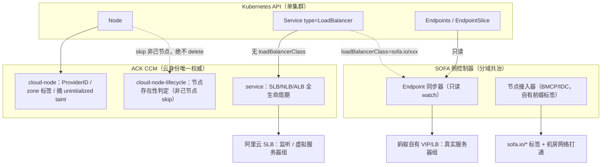

> **生产环境安全提示**
>
> 本文第六节的收敛操作涉及控制器 RBAC 收敛与 Service 重建（loadBalancerClass 不可变），属变更操作：先在非生产验证；收敛 RBAC 前确认对方控制器职责边界，避免误收导致自有 LB 断管。命令风险等级：🔴 高风险（删 Node、删 finalizer）、🟡 中风险（RBAC 收敛、重建 Service）、🟢 低风险（只读排查）。

# 双 CCM 分域共治深度剖析（SOFA CCM × ACK CCM）

> **定位**：回答"蚂蚁侧 SOFA CCM 能不能叠在 ACK CCM 上、两个 CCM 怎么配合干活"。
> **配套面试卡**：[[36-报告/k8s-高级面试快问快答-沉淀.md|快问快答沉淀]] Q72（架构卡）、Q115（排障卡）。
> **前置阅读**：[[01-集群基础/03-控制平面/14-cloud-controller-manager-deep-dive.md|cloud-controller-manager 深度解析]]

## 📋 目录

- [一、结论先行](#一结论先行)
- [二、为什么不能是两个"全功能"CCM](#二为什么不能是两个全功能ccm)
- [三、分域共治架构总览](#三分域共治架构总览)
- [四、四条配合机制详解](#四四条配合机制详解)
- [五、SOFA 侧控制器的实质形态：为什么它能叠](#五sofa-侧控制器的实质形态为什么它能叠)
- [六、冲突自检信号与排查收敛手册](#六冲突自检信号与排查收敛手册)
- [七、先例与边界](#七先例与边界)
- [八、常见误区（红线）](#八常见误区红线)
- [九、相关概念](#九相关概念)
- [十、参考链接](#十参考链接)

---

## 一、结论先行

**可以叠加，但形态必须是"分域共治"，绝不是装第二个全功能 CCM。**

K8s 官方语义：一个集群只有一条 cloud provider 通道——kubelet `--cloud-provider=external` 对应唯一的 CCM。"叠加"成立的唯一方式，是两个控制器把**对象所有权切开**：

| 域 | ACK CCM（唯一云权威） | SOFA 侧控制器（分域共治） |
|---|---|---|
| LB Service | 无 `loadBalancerClass` 的 type=LoadBalancer：SLB/NLB/ALB 全生命周期 | 设了 `spec.loadBalancerClass: sofa.io/xxx` 的 Service；或对 K8s 只读 |
| Node 云身份 | ProviderID、topology 标签、uninitialized taint、节点存在性判定 | 只加自有前缀标签（`sofa.io/...`），不做存在性判定、不删节点 |
| 云资源写路径 | 阿里云 SLB 监听 / 虚拟服务器组 | 蚂蚁自有 VIP / LB 真实服务器组（不同实例） |
| finalizer | `service.kubernetes.io/load-balancer-cleanup` | 自有前缀 `sofa.io/lb-cleanup` |
| 选举 / RBAC | 独立 Lease + ACK RAM 角色 | 独立 Lease + 最小化 RBAC（无 nodes delete） |

一句话本质：**CCM 之争是对象所有权之争；配合 = 划分所有权 + 各写各的资源。**

---

## 二、为什么不能是两个"全功能"CCM

### 2.1 K8s 的单实例语义

- kubelet 以 `--cloud-provider=external` 启动时，节点注册后被打上 `node.cloudprovider.kubernetes.io/uninitialized=true:NoSchedule` taint，等 CCM 的 cloud-node 控制器填好 **ProviderID**、NodeAddresses、`topology.kubernetes.io/zone|region`、`node.kubernetes.io/instance-type` 后才摘除——这一套"云身份初始化"只能有一个执行者；
- KCM 侧 `--cloud-provider=external` 后不再运行云相关控制器，职责整体移交 CCM 的四大控制器：**cloud-node / cloud-node-lifecycle / route / service**（详见 [[01-集群基础/03-控制平面/14-cloud-controller-manager-deep-dive.md|CCM 深度解析]]）；
- `cloudprovider.Interface` 是单一注入点：组件设计假设"一个集群一个云实现"，没有多 provider 组合机制。社区对多云需求的答案是**多集群**（每朵云一个集群 + Karmada/OCM 联邦），不是单集群多 CCM。

### 2.2 全功能双 CCM 的四类冲突面

① **节点误删机关（最危险）**：cloud-node-lifecycle 的正当逻辑是"向云 API 确认实例存在，不存在 → 删 Node 对象"。第二个 CCM 拿 ECS 节点去查**自己的**云，查不到 → 判定"实例不存在" → 删节点。叠加第二个 CCM 时，这条正当逻辑就变成误删机关。

② **LB 双写互踢**：两个 service 控制器都处理 type=LoadBalancer → 各建一个 LB、`status.loadBalancer.ingress` 互写覆盖（客户端看到的 VIP 来回抖）；后端服务器组是"全量对齐"语义，两边全量 set → 后端反复增删 → 流量 flapping。

③ **路由双写**：route 控制器都往路由表写 PodCIDR 路由（Flannel/云路由模式；Terway ENI 模式下 ACK CCM 的 route 控制器本来就关闭，冲突面小但仍在）。

④ **finalizer 拉锯 + 审计混乱**：LB Service 的 `service.kubernetes.io/load-balancer-cleanup` 两边都认领 → 删除卡 Terminating、finalizer 一加一摘（并发写 finalizer 的坑见 [[22-概念/01-核心架构/04-finalizer-deletion-lifecycle.md|finalizer 删除生命周期]]）；事件风暴，ActionTrail 里两个 RAM 身份交叉改同一批资源，排障成本指数级上升。

---

## 三、分域共治架构总览

---

## 四、四条配合机制详解

### 4.1 所有权声明：loadBalancerClass 是官方分域开关

- `spec.loadBalancerClass`（KEP-1959：1.21 alpha → 1.22 beta → **1.24 GA**）：**设置了 class 的 Service，云厂商默认 service 控制器直接忽略**，由声明了匹配 class 的第三方控制器（MetalLB、SOFA 侧）接管——这是 K8s 为"多个 LB 实现共存"设计的正统机制；
- 三个注意：**不可变**（建 Service 时定死，改只能重建）；class 是带域名前缀的字符串（如 `sofa.io/custom-lb`）；设了 class 后云厂商不再管该 Service 的 LB 生命周期（含删除时的清理）；
- 老控制器没跟 class 语义时，退化为**注解/标签分域**：informer 过滤，只处理带自己注解的 Service；
- **存量资源声明样板**：ACK CCM 复用已有 SLB 走 `service.beta.kubernetes.io/alibaba-cloud-loadbalancer-id`，且默认**不覆盖**已有监听（`...-force-override-listeners` 默认 false）——"存量实例不归我重建、监听主权还在原主人"的所有权声明，双控制器分域可直接借用这个模式。

### 4.2 云资源物理隔离

- 首选不同 LB 实例：阿里云 SLB 一套、蚂蚁自有 VIP 一套，物理上不存在同一个对象的双写；
- 若必须共享一个 LB 实例：拆监听/虚拟服务器组，且**明确唯一后端写者**——绝不允许两边对同一个 vGroup 做全量 set；
- 判断线：后端列表的"全量对齐"语义是互踢根源，**谁全量，谁独占**。

### 4.3 云身份单权威

- ProviderID、topology 标签、uninitialized taint 摘除、节点存在性判定 → 只归 ACK CCM；
- SOFA 侧标签一律自有前缀 `sofa.io/...`，不碰 `topology.kubernetes.io/*`、`node.kubernetes.io/instance-type`；
- IDC/裸金属（BMCP）节点由 SOFA 侧接入时：赋自有 ProviderID 方案，双方对"非己节点"一律 **skip 不 delete**——原则："**查不到 ≠ 不存在，只有持有该节点云身份的一方才有删除判定权**"。

### 4.4 写路径隔离

- finalizer 前缀化：`sofa.io/lb-cleanup` vs 系统 `service.kubernetes.io/load-balancer-cleanup`；
- 独立 ServiceAccount + 最小 RBAC：SOFA 侧对 Service/Node 只读 + 只写自有前缀注解与 status，**无 `nodes delete`**；
- 独立 Lease 选举对象（`kube-system/sofa-ccm-leader-election` 与 CCM 的互不感知，可独立重启回滚，原理见 [[10-平台工程/02-运维/15-lease-leader-election.md|Lease Leader 选举]]）；
- 独立发布窗口：一边发版另一边冻结，出问题回滚半径不交叉。

---

## 五、SOFA 侧控制器的实质形态：为什么它能叠

它不是 `cloudprovider.Interface` 的第二个实现，而是三类"**K8s 侧只读、云侧写自有系统**"的控制器：

1. **Endpoint 同步器**：watch Service/EndpointSlice → 调蚂蚁自有 LB/VIP OpenAPI 对齐真实服务器组——类似外置 LB 控制器，K8s 侧零写冲突；
2. **节点接入器**：BMCP 裸金属/IDC 节点注册、自有标签、机房网络打通（专有云场景的天然需求）；
3. **单元化流量联动**：LDC 场景按 unit/zone 聚合 Endpoints 推给流量接入层。

**叠加可行的充要条件**：两个控制器在 K8s 对象上的**写集合不相交**（Service 划分 + Node 划分 + 注解前缀划分），在云资源上的**物理对象不相交**。

---

## 六、冲突自检信号与排查收敛手册

### 6.1 信号清单

| 信号 | 现象 | 指向 |
|---|---|---|
| ingress IP 抖 | `kubectl get svc -w` 看 `status.loadBalancer.ingress` 来回换 | 两边互写 status |
| 后端高频增删 | SLB 控制台后端服务器变更记录密集 | 两边全量同步互踢 |
| 标签/taint 反复 | zone 标签消失又出现、uninitialized taint 回来 | cloud-node 竞争 |
| **节点莫名被删** | Node 对象消失、节点上 Pod 被驱逐 | **node-lifecycle 误删机关，最高优先级** |
| 删除卡 Terminating | finalizer 一加一摘 | finalizer 拉锯 |
| 事件风暴 | `EnsuringLoadBalancer`/`SyncLoadBalancerFailed` 高频重复 | 双 service 控制器 |

### 6.2 定位四步

① **Service 归属**：`kubectl get svc <name> -o yaml` 看 `spec.loadBalancerClass` 和注解 → 确认应归谁；

② **云侧审计**：ActionTrail 按时间窗查哪些 RAM 身份在改监听/后端/实例 → 拿到"第二个写者"的身份证；

③ **日志对齐**：两个控制器 Pod 日志按时间线交叉，确认同对象的交叉写；

④ **RBAC 盘点**：`kubectl get clusterrolebinding,rolebinding -o yaml` → 谁有 `nodes delete`、`services patch`。

### 6.3 收敛三步

1. **定唯一写者**：按域定主——云资源默认归 ACK CCM，自有设施归 SOFA 侧；
2. **划界**：需 SOFA 侧接管的 Service 统一设 `spec.loadBalancerClass`（不可变，需重建 Service，切 VIP 前双跑）；非主方 RBAC 收到"只读 + 自有前缀注解写"；
3. **固化**：观察一个发布周期无抖动后，用 admission/策略固化"无 class 的 LB Service 一律归 ACK CCM"，防止下一个控制器再进来抢。

---

## 七、先例与边界

- **ACK One 注册集群**：IDC 自建集群接入 Fleet 后，云资源仍各归各集群的 CCM，Hub 不碰云资源——"多云放集群外解决"的官方实践（[[18-云厂商/01-阿里云/分布式云-ACKOne/01-ack-one-multi-cluster-architecture.md|ACK One 多集群架构]]）；
- **MetalLB 与云 CCM**：`loadBalancerClass` 正是这类共存的标准通道；
- **双通道天然免冲突**：公网 SLB 与机房内 VIP/单元化流量是物理两条通道；
- **边界**：一个集群装两个全功能 CCM 从来不是可行路线；跨云需求走多集群联邦（[[28-资产/architecture-diagrams/architecture-multi-cluster.md|多集群架构模式]]）。

---

## 八、常见误区（红线）

- ❌ "直接部署第二个 CCM 就行"——完整身份双 CCM 必然抢 Node/LB，且可能触发节点误删机关；
- ❌ 两个控制器管同一个 SLB 的同一批监听/后端组——后端列表互相覆盖；
- ❌ 说 K8s 官方支持多 CCM——官方语义一个集群一个 cloud provider；
- ❌ 看到后端抖就重启 CCM——抢写不解决，重启后照旧；
- ❌ 给存量 Service 现场改 `loadBalancerClass`——字段不可变，只能重建滚动切。

---

## 九、相关概念

- [[01-集群基础/03-控制平面/14-cloud-controller-manager-deep-dive.md|cloud-controller-manager 深度解析]]
- [[01-集群基础/03-控制平面/13-kube-controller-manager-deep-dive.md|kube-controller-manager 深度解析]]
- [[22-概念/01-核心架构/04-finalizer-deletion-lifecycle.md|finalizer 与删除生命周期]]
- [[10-平台工程/02-运维/15-lease-leader-election.md|Lease Leader 选举]]
- [[17-系统基础/06-知识字典/networking/loadbalancer.md|LoadBalancer 知识字典]]
- [[13-生产运维/05-工单案例/ticket-case-003-slb-backend-group-misconfig.md|SLB 后端组配置工单案例]]
- [[01-集群基础/03-控制平面/26-multi-cloud-hybrid-deployment.md|多云混合部署]]
- [[18-云厂商/01-阿里云/分布式云-ACKOne/01-ack-one-multi-cluster-architecture.md|ACK One 多集群架构]]
- [[28-资产/architecture-diagrams/architecture-multi-cluster.md|多集群架构模式]]

---

## 十、参考链接

- Kubernetes 官方文档：cloud-controller-manager 架构（cloud-node / cloud-node-lifecycle / route / service 四控制器）
- KEP-1959：Service `loadBalancerClass`（1.21 alpha → 1.24 GA）
- 阿里云 ACK：Cloud Controller Manager 产品文档；Service 负载均衡注解（含 `alibaba-cloud-loadbalancer-id` 复用存量 SLB、`force-override-listeners`）
- MetalLB 文档：与云 provider 共存的 class 声明模式
