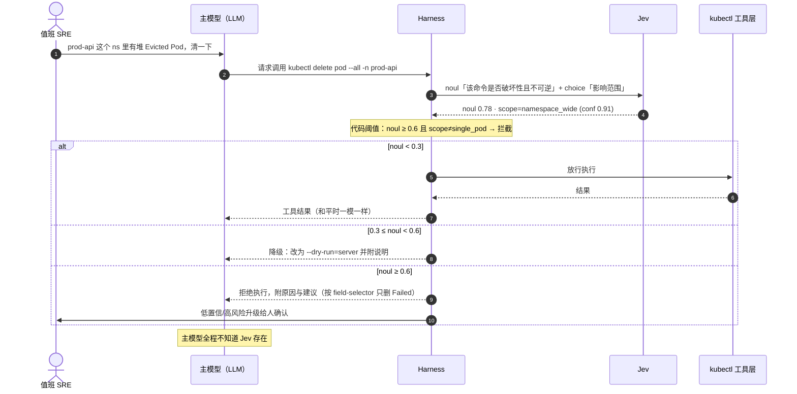

# Jev 判断模型（System One Model）与 K8s 运维判断层设计

> **一句话定位**：Jev 是 TypeSafe 公司 2026 年 9 月推出的「判断模型」——和 LLM 一样是训练出来、走 API 调用的神经网络，但**不生成文字**：你给它现场材料（`state`）和一组问题，它返回"选哪个 / 打几分 / 是不是"的类型化判断，附带置信度和概率分布，让代码直接消费。在 K8s 运维 Agent 里，它的生态位是接走循环中那些"要做判断、不用写文章"的时刻：这条事件该不该处理、这条 `kubectl delete` 危不危险、这次 rollout 算不算完成。

本文回答三个问题，先给结论：

| 问题 | 结论 |
|---|---|
| 能不能"针对 K8s 输出一个 Jev"？ | **能，而且不需要训练。** Jev 不做垂直微调、不做私有化，定制只靠每次调用的 `state` + `questions`。写好一套 K8s 判断模板，就是"K8s 版 Jev"。 |
| 能不能自己训练一个 Jev？ | **Jev 本体不能**（权重/训练数据/架构闭箱，所有账户共享同一组权重）。**能训的是"Jev 范式"的开源替代**——可微分逻辑门网络（difflogic 一族，即坊间说的"与非门模型"），特征向量输入、类别固定、CPU 微秒级推理，Mac 就能训。 |
| 多少钱？ | 官方 API：拆解文口径输入 $0.042/百万 token、输出免费（官方无公开定价页，以 console 账单为准）；每天 1 万次判断约 ¥3–6。自建逻辑门网络：算力 ¥0–20，真实成本是标注数据。 |

---

## 1. Jev 是什么：分布长在"答案字段"上的模型

"模型"这个词有两种日常用法，先拆掉歧义：

- **语言模型的"模型"**：输入文字、预测下一个 token、连成文章。ChatGPT、Claude、Qwen 是这种。
- **机器学习课本的"模型"**：一切训练出来的神经网络——图像分类器、风控打分、语音识别，都不写文章。

Jev 是第二种。两者数学上同类（都输出概率分布），区别只在**分布长在哪儿**：LLM 的分布长在"下一个 token"上，采样出来是文字；Jev 的分布直接长在**你问题的答案字段**上——选哪个标签、落在量尺哪一档、为真的概率多大——API 返回的就是这些数字，不存在"采样成文章"这一步。所以别把它理解成"小号聊天模型"，那是读错了它的输出空间。

官方给这个类别起的名字叫 **System One Model**，致敬卡尼曼的系统一/系统二：LLM 像系统二（慢慢想、写一大段），Jev 像系统一（看完现场、凭内行直觉直接给判断，还附带"我有多确定"）。

### 1.1 三个常见误会

| 说法 | 实际 |
|---|---|
| "Jev 写的这段 YAML……" | 错。Jev 不产代码、不产文字。那是**用 Jev 做决策部件的 Agent** 写的，主笔仍是 LLM |
| "Jev 是个 Agent 框架" | 错。它就是一个模型 + 一个 API，不带循环、不带工具、不带记忆 |
| "Jev 要替代 LLM" | 错。它不碰"生成"，只接管循环里的"判断"，和 LLM 是分工关系 |

### 1.2 LLM / Agent / Jev 三者对照

| | 输入 | 输出 | 你拿它干嘛 |
|---|---|---|---|
| **LLM** | 文本 | 文本（一段话 / 代码 / YAML） | 生成、解释、写修复方案 |
| **Agent** | 目标 | 一系列动作 + 最终结果 | 完成任务（LLM 当大脑，程序跑循环） |
| **Jev** | `state` + 一组问题 | 结构化判断（标签 / 分数 / 概率） | 给循环里每个"犹豫时刻"做快判 |

---

## 2. API 契约：state + 三种原语

### 2.1 state：Jev 眼里的全部世界

`state` 是你希望它看的"现场材料"——一段文本（错误日志、diff、工单）或一个 JSON 对象/数组（一条 Event、一份 describe 摘要）。关键性质：**Jev 只知道你给它的 state**。它没有工具、不能上网、没有历史记忆、不会反问你。state 里没有的信息它就不知道；state 是垃圾，判断就是垃圾——而且它照样会给你一个像模像样的置信度。

### 2.2 三种问题原语（Primitive）

| 原语 | 问什么 | 返回什么 |
|---|---|---|
| **Choice** | 从你给的选项字典 `{标签: 描述}` 里选一个 | `choice`（选中标签）+ `confidence`（0–1）+ `probabilities`（每个选项的概率） |
| **Score** | 按你定的**有序量尺**（≥2 档，从 0 计数）打分 | `score`（**期望分，可落在两档之间**，如 1.4）+ `confidence` + `probabilities` |
| **Noul** | 这句话是真的吗 | `noul`：0–1 的"是"概率（可分别给"是/否"写描述帮它对齐标准） |

`confidence` 与 `probabilities` 的区别：前者是模型对**它最终给出的那个答案**的整体置信；后者是**所有选项各分到多少概率**的完整分布。前者一个数，后者一张表。Score 返回期望分而非取整，是因为它内部是对整条量尺的分布再加权——比强制取整保留更多信息。

### 2.3 端点与并行语义

- 端点：`POST https://api.typesafe.ai/v1/systemone`；默认模型别名 `jev-latest`；SDK 从环境变量 `TYPESAFE_API_KEY` 读密钥。
- **一次调用可以带任意多个问题，所有问题并行、各自独立地对着同一份 state 评估**。官方明确说"加问题几乎不改变响应时间"，且因为隔离评估，加问题不产生 context rot（上下文越塞越稀释的现象）。这意味着整套 checklist（安全、完成度、优先级）可以塞进同一次调用。
- 上下文窗口：拆解文给出 64k token（state + 单个问题最长 32k）；吞吐与限速数字（25 万 token/s、64k req/min）同样来自拆解文，以官方文档为准。

### 2.4 一次 K8s 风格的调用

裸 HTTP（这就是 SDK 底下发的东西），state 换成一条精简后的 Pod 事件：

```sh
curl -X POST https://api.typesafe.ai/v1/systemone \
  -H "Authorization: Bearer $TYPESAFE_API_KEY" \
  -H "Content-Type: application/json" \
  -d '{
    "model": "jev-latest",
    "state": {
      "kind": "Event",
      "reason": "Evicted",
      "message": "The node was low on resource: memory. Container api was using 1.9Gi, request is 512Mi",
      "involvedObject": {"kind": "Pod", "namespace": "prod-api", "name": "api-7c9d-xk2lp"},
      "count": 3,
      "window": "last 10m",
      "node": {"MemoryPressure": "True", "allocatable_mem_used_pct": 0.97},
      "recent_change": "api Deployment rolled out 25m ago (image tag v2.14.0)"
    },
    "questions": {
      "triage": {
        "type": "choice",
        "instructions": "这条事件现在该怎么处理？",
        "criteria": {
          "act_now": "需要立即人工介入或自动修复",
          "watch": "先观察，有恶化趋势再处理",
          "noise": "预期内的噪声，可忽略"
        }
      },
      "change_related": {
        "type": "noul",
        "instructions": "这次驱逐是否大概率由 25 分钟前的发布引起？"
      },
      "severity": {
        "type": "score",
        "instructions": "影响严重度",
        "criteria": ["单 Pod 抖动", "单服务降级", "多服务受影响", "节点级故障"]
      }
    }
  }'
```

TypeScript SDK 写法（`npm install @typesafe-ai/sdk`）：

```ts
import { choice, noul, score, TypeSafeClient } from "@typesafe-ai/sdk";

const client = new TypeSafeClient(); // 自动读 TYPESAFE_API_KEY

const res = await client.systemOne({
  state: slimEvent,            // 见 §5.7：裁剪后的事件 + 节点压力 + 最近变更
  questions: {
    triage: choice("这条事件现在该怎么处理？", {
      act_now: "需要立即人工介入或自动修复",
      watch: "先观察，有恶化趋势再处理",
      noise: "预期内的噪声，可忽略",
    }),
    change_related: noul("这次驱逐是否大概率由最近的发布引起？"),
    severity: score("影响严重度", ["单 Pod 抖动", "单服务降级", "多服务受影响", "节点级故障"]),
  },
});

res.answers.triage.choice;         // "act_now"
res.answers.triage.confidence;     // 0.88
res.answers.triage.probabilities;  // { act_now: 0.74, watch: 0.21, noise: 0.05 }
res.answers.change_related.noul;   // 0.81
res.answers.severity.score;        // 1.6（介于"单服务降级"和"多服务受影响"之间）
```

官方把这叫"前沿智能函数调用"——和 LLM 的 function calling 方向相反：LLM 是**模型生成一个 JSON 让你去调函数**，Jev 是**模型本身就是一个可调用的函数**——入参 `state + questions`，出参类型化结构，没有一个字的废话。三个工程红利：**快**（不等几百个 token 生成完）、**便宜**（输出就几十字节）、**可靠**（schema 是你定义的，不存在"解析失败重试三遍"）。

---

## 3. 两种挂法与三类挂载点

这是大多数人最模糊的一点：Jev 在 Agent 循环的**哪一步**发生？取决于你怎么接。

**挂法一：主模型把它当工具主动调用。** 主模型像调 `bash` 一样调它，在判断点上问一嘴。要花 token 教主模型"什么时候该问"。

**挂法二（更像"系统"）：Harness 在工具执行前后自动问，主模型全程无感。** Harness 指 Claude Code、DSH 这类"模型外面那层程序"——它可以在放行危险命令之前、在工具结果落盘之后自己去问 Jev，用代码按阈值分支。这是 Jev 最有意思的用法：**主模型根本不知道 Jev 存在**，不需要花 token 教它。

把挂法二套到 K8s 运维 Agent 上：



三类挂载点速查（K8s 版）：

| 挂载点 | 时机 | 典型问题 | 原语 |
|---|---|---|---|
| 循环中的判断点 | 每一轮思考时 | 继续排查 / 换思路 / 问人 / 停 | Choice |
| 工具执行前 | 放行 `kubectl`/`helm`/`etcdctl` 之前 | 这条命令破坏性吗、可逆吗、影响范围多大 | Noul + Choice |
| 工具执行后 | rollout / apply 结果落地时 | 变更完成了吗、健康度几分、要不要回滚 | Noul + Score |

**铁律：副作用和阈值留在你的代码里，Jev 只出概率。** `noul < 0.3 放行` 这样的分支写在 harness 里，而不是让 LLM 去读 Jev 的输出再"理解一遍"——后者等于把省下来的钱又花回去了。一句话记住边界：**Jev 回答问题，不执行决定。**

---

## 4. 为什么能毫秒级且近乎免费

"快、便宜"不是玄学，四个可说的原因（第 1 点是官方口径，内部多大、怎么训没公开；2–4 是 API 层可直接验证的行为）：

1. **它不为"说人话"付账。** LLM 的训练目标是生成流畅文本，每个 token 一个一个往外蹦；Jev 的训练目标是**校准过的判断**（官方原话："训练模型做校准决策，而不是生成文本"）。输出从几百 token 变成一个标签加几个数字，延迟和成本差出量级。
2. **问题并行且隔离。** 一次调用塞任意多个问题，各自独立评估，加问题几乎不加时、不互相干扰。
3. **概率是一等公民，代码直接消费。** LLM 回你"我觉得可以"，这个"觉得"没法编程；Jev 回你 `noul=0.04, confidence=0.92`，代码就能写 `if (noul < 0.3)`。判断从"不可编程的意见"变成"可编程的信号"——官方文档里的 **confidence-gated routing（置信门控路由）** 就是这个模式。
4. **架构红利：把判断从串行思考里剥离。** LLM 按 turn 串行干活，每次"再想一下"都是一次完整调用；高频小判断下沉后，LLM 的 token 全花在生成和执行上。官方还给了更激进的 **speculative fan-out（投机扇出）**：几个候选方案并行跑，让 Jev 挑最好的——用便宜的概率赌注替代昂贵的串行纠结。

把这套分工画成栈，就是拆解文总结的四层：

| 层 | 谁 | 干什么 |
|---|---|---|
| **发现层** | 强生成模型 | 提出新问题、新流程（"这个 OOM 模式像是定时任务诱因"） |
| **判断层** | Jev 这类快模型 | 高频语义判断，充当"反射层" |
| **执行层** | 程序 | 算术、约束、动作（阈值、kubectl、回滚） |
| **验证层** | 真实业务结果 | 测量残差回流，形成闭环（处置是否正确 → 校准数据） |

一句话：**强模型探索、快模型判断、代码执行、人兜底。**

---

## 5. K8s 运维落地：六个判断点的设计模板

> 本节是本文基于 Jev 公开契约做的**场景设计**，非官方案例。原则两条：每个问题是"内行几秒钟就能判"的原子问题；阈值与动作在代码里。

### 5.1 事件分诊（Event triage）— Choice

- **state**：精简 Event（reason / message / involvedObject / count / 时间窗）+ 所在节点 Condition + 最近变更摘要。
- **问题**：`triage ∈ {act_now, watch, noise}`；可并行加 `change_related`（Noul）帮助定位"是不是发布引起"。
- **动作**：`act_now` 且 `confidence ≥ 0.8` → 开工单/触发 runbook；`watch` → 进 10 分钟观察队列；`noise` 且 `probabilities.noise ≥ 0.9` → 静默并计数。

### 5.2 告警分级（Alert grading）— Score

- **state**：告警 payload（规则名、labels、当前值 vs 阈值、持续时长）+ 受影响服务的 SLO 余量 + 最近 1h 变更。
- **量尺**：`["P3 看板", "P2 工作时间处理", "P1 立即拉人", "P0 全员响应"]`。
- **动作**：期望分 ≥ 2.5 走 P1/P0 通道；1.5–2.5 进 P2 队列且附 `probabilities` 给值班参考；< 1.5 只上看板。期望分落在档间（如 2.3）本身就是信息——"介于白天处理和立即拉人之间"，比强制取整更适合做二次规则。

### 5.3 危险命令门控（Destructive-op gate）— Noul + Choice（工具执行前）

- **state**：待执行命令全文 + 目标资源摘要（kind / ns / 副本数 / 是否生产）+ 当前时间窗（是否变更冻结期）。
- **问题**：`destructive`（Noul："破坏性且不可逆？"）、`scope`（Choice：`single_pod / workload / namespace_wide / cluster_wide`）。
- **动作**：见 §3 时序图三段式。典型需拦的形态：`kubectl delete ns`、`kubectl delete pod --all`、`kubectl drain --force --delete-emptydir-data`、`helm uninstall`、`etcdctl del`、`kubectl patch` 改 finalizers。
- **提醒**：这是**叠加**在 RBAC / 准入控制之上的一层，不是替代——RBAC 管"能不能"，门控管"该不该现在这么做"。

### 5.4 变更验收（Rollout acceptance）— Noul + Score（工具执行后）

- **state**：`rollout status` 输出 + 新旧 ReplicaSet 就绪数 + 关键指标窗口摘要（错误率、P99 延迟相对发布前的变化）+ 新增 Warning 事件计数。
- **问题**：`completed`（Noul："发布是否健康完成？"）、`rollback_need`（Score：`["不需要", "观察", "建议回滚", "必须回滚"]`）。
- **动作**：`completed ≥ 0.85` → 标记成功；`rollback_need ≥ 2.5` 且 `confidence ≥ 0.8` → 自动 `rollout undo`（仅限事先白名单的无状态服务）；其余升级给人。

### 5.5 工具路由（Tool routing）— Choice

- **state**：用户诉求 + 当前已知现象。
- **问题**：`next_tool ∈ {describe, logs, events, exec, metrics_query, ask_user}`。
- **价值**：把"下一步该查什么"这种每轮都发生的小判断从 LLM 剥出来，LLM 只在拿到材料后做解释与生成。

### 5.6 值班打断（On-call interrupt）— Noul

- **state**：告警摘要 + 分级结果 + 时间（深夜？）+ 自动修复是否已尝试及结果。
- **问题**："现在是否值得叫醒值班人？"
- **动作**：`noul ≥ 0.7` 电话；0.4–0.7 IM 推送不响铃；< 0.4 合并到早班摘要。这是降噪里最被低估的一环——"该不该叫人"本身就是一个可量化的判断。

### 5.7 原子问题拆解与置信门控（通用）

**别问"这个节点健康吗"**——这是坏问题。拆成四个原子 Noul 在同一次调用里并行问，再在代码里加权：

```ts
const q = {
  mem_pressure:  noul("节点是否处于内存压力？"),
  disk_pressure: noul("节点是否处于磁盘压力？"),
  kubelet_stale: noul("kubelet 心跳是否已过期？"),
  pleg_unhealthy: noul("PLEG 是否不健康？"),
};
// 权重是你代码里的系数，想调优先级改一行，不用重写 prompt
const risk = 0.35*a.mem_pressure.noul + 0.2*a.disk_pressure.noul
           + 0.3*a.kubelet_stale.noul + 0.15*a.pleg_unhealthy.noul;
```

**置信门控三段式**（所有判断点通用）：

| 区间 | 动作 | 理由 |
|---|---|---|
| 高置信（如 `confidence ≥ 0.85`） | 自动执行白名单内动作 | 错误成本低、可逆 |
| 中置信（0.5–0.85） | 降级：只告警 / `--dry-run=server` / 进观察队列 | 不动作但留痕 |
| 低置信（< 0.5） | 升级给人，附 `probabilities` | 让人看到模型在哪两个选项间犹豫 |

**state 怎么裁**（判断质量 = state 质量）：

- 给**精简字段**，不给整份 YAML dump：Event 只要 reason/message/involvedObject/count/时间窗；describe 只要 Conditions、最近 Events、资源 request/limit。
- 永远附上**最近变更**（发布、配置、节点操作）——绝大多数生产判断的关键证据。
- **脱敏**：Secret 值、Token、证书、业务敏感字段一律不进 state；内网 IP / 主机名按策略哈希或白名单（§7）。

---

## 6. "针对 K8s 做一个 Jev"：三条路线与成本

### 6.1 路线 A：模板化调用官方 API（不训练）

- **原理**：Jev 官方**不做私有化部署、不做垂直微调、不用客户数据做 LoRA**，所有账户共享同一组权重；适配只通过 `state` / `instructions` / `criteria`（即 questions）完成。所以"K8s 版 Jev"= §5 那套模板 + 阈值代码。
- **资源**：一个 API key（console.typesafe.ai 开放注册，无需审批）+ 把判断任务写成原子问题 + 一段 harness 代码。无 GPU、无训练。
- **产物**：接在你的运维 Agent / 告警管道上的判断层；开 Playground 贴一条事件、加几个问题即可验证。

### 6.2 路线 B：自建"Jev 范式"替代 —— 可微分逻辑门网络（difflogic）

你听到的"与非门判断型模型"，指的是这条研究线：**Deep Differentiable Logic Gate Networks**（Petersen 等，NeurIPS 2022；卷积版 NeurIPS 2024；2026 年有连接也可训练的"Fully Trainable"版本）。要点：

- **结构**：每个"神经元"不是加权求和，而是一个二元逻辑门（AND / NAND / OR / XOR……共 16 种两输入布尔函数），固定接两个上游输入。
- **怎么训**：训练时把离散门**松弛**成连续版本（对 16 种门做 softmax 混合、输入用实值概率逻辑），梯度可过；训练完**离散化**成 argmax 那一种门——推理时就是一张纯布尔电路，CPU 上微秒级、FPGA 上更夸张。
- **输入**：**特征向量（二值化 / 阈值化的特征）**，不是自然语言。这是和 Jev 最大的差别——Jev 前面有文本编码器，difflogic 没有。
- **K8s 特征工程示例**：Event reason one-hot、重启次数分桶、CPU/内存水位分档、节点 Condition 位图、是否变更窗口内、时间段（深夜/工作时间）、受影响副本比例分档……几十到几百个二值特征足够。
- **数据**：几千条"特征 → 正确判断"的标注样本。来源：历史告警 + 真实处置结果（这本来就是 §4 验证层应该沉淀的东西），LLM 预标 + 人工抽检。**这才是真实成本**——几个晚上的活。
- **算力**：这类网络极小，**Mac / 笔记本 CPU 即可**（MNIST 级任务几分钟）；要快就租一张 4090（约 ¥2/小时），全部实验 ¥10–20 跑完。
- **产物**：类别固定的分类器，可嵌进 admission webhook、告警管道、甚至 kubelet 旁路程序；**没有外部依赖，专有云 / 离线环境可用**。
- **限制**：①没有 Jev"自然语言现场定义选项"的能力（类别训练时钉死，加一类就重训）；②复刻的是**接口范式**不是 Jev 本体——拆解文明说官方的编码器与 RLCD 训练细节闭箱，"任何开源复刻版都未复现 RLCD 本身"；③Jev 内部是否真用逻辑门网络，官方从未确认，"与非门"只是社区的关联说法。

### 6.3 路线 C：flash 级 LLM 做判断层（零接入基线）

用百炼 qwen-flash 这类便宜模型 + JSON 输出 / function calling 做分类。**钱上和 Jev 同量级**（flash 级输入也是每百万 token 几毛到一两块人民币，单次判断可忽略）——差别不在钱，在：延迟（几百毫秒到秒级 vs 毫秒级）、**没有校准概率**（LLM 给的"0.9"是生成出来的数字不是分布）、输出格式偶发失效、多问题不隔离（会 context rot）。适合先跑基线对比，再决定是否值得引入专用判断模型。

### 6.4 成本汇总

| 路线 | 一次性成本 | 持续成本 | 适用 |
|---|---|---|---|
| A. 官方 API 模板化 | ¥0（写模板 + 阈值代码） | 输入 $0.042/百万 token、输出免费（拆解文口径）。每次判断 1–2K token ≈ ¥0.0003–0.0006；1 万次/天 ≈ ¥3–6/天 ≈ ¥100–200/月 | 公有云、可外发脱敏数据、要"自然语言定义选项"的灵活性 |
| B. difflogic 自建 | 标注数据人工 + 算力 ¥0（Mac）～¥20（租卡） | ≈0，纯布尔电路 CPU 推理 | 专有云 / 离线 / 数据不能出域、类别稳定、超高频 |
| C. flash 级 LLM | ¥0 | 与 A 同量级 | 基线对比、低频、对延迟和校准不敏感 |

算式说明：$0.042 ÷ 1,000,000 × 1,500 token ≈ $0.000063/次，按 ¥7/$ ≈ ¥0.00044；×10,000 次 ≈ ¥4.4/天。注意两处不确定：GitHub 科普文指出**官方没有公开定价页，以 console 账单为准**；拆解文提醒低价可能含补贴、官方宣称的"快 193.6 倍、省 444.6 倍"只在短密输入等理想条件成立，倍率不能跨行业照搬。

### 6.5 决策树：K8s 运维要不要引入判断模型

```
这个判断点是否同时满足：文本/结构化输入 · 动作可枚举 · 秒级可判 · 高频 · 允许置信分流？
├─ 否 → 不是判断模型的活：解释根因/生成修复 → LLM+RAG；长链规划 → Agent；否则人工
└─ 是 → state 能否脱敏后外发到第三方 API？
      ├─ 能（公有云、非敏感） → 路线 A 模板化调用，先用 Playground 验证，再用历史数据验校准
      └─ 不能（专有云/离线/合规） → 路线 B difflogic 自建（或内网小模型），类别先冻结
```

---

## 7. 冷静清单与红线（K8s 场景特化）

- **非常新。** 公司公开仓库和 SDK（`@typesafe-ai/sdk` v0.6.0）2026 年 8–9 月才出现，没有权威第三方评测；社交媒体上的热度案例多是"用 Jev 做决策核心的 Agent"演示，不是 Jev 单打独斗。
- **confidence 的校准度要自己验。** "校准"是训练目标，不等于每个 0.9 都真的九成靠谱。正式用在门控前，拿你自己的历史告警 + 真实处置结果画可靠性曲线（预测概率 vs 实际命中率），再定阈值；上线后让 §4 的验证层持续回流。
- **判断质量 = state 质量。** 它不看现场以外的一切，材料少了它也敢答，还带个像样的置信度——所有概率接口的共同陷阱。
- **数据出域。** 集群事件、日志、manifest 发给第三方 API 就是出域：Secret/Token/证书绝不能进 state；内网拓扑按策略脱敏；专有云 / 离线 / 强合规场景外部 API 不可达也不可用，只剩路线 B。
- **Jev 不执行决定。** 放行、拦截、回滚永远在代码里；高错误成本且没有兜底流程的场景（删 ns、drain 生产节点、改 etcd）不要交给任何概率接口自动执行，判断层只负责"该不该升级给人"。
- **不适合的事别硬塞**：解释为什么 etcd 慢、生成修复 YAML、跨多步的排障规划、多模态——那是 LLM + RAG + Agent 的活。复杂问题拆成多个原子判断在代码里加权，而不是一次性提问。
- **定价不透明。** 以 console 账单为准，不要把任何倍率当承诺。

---

## 8. 面试口径（压缩版）

**一句话**｜把运维 Agent 循环里"要判断但不用写字"的时刻从 LLM 剥出来，交给只输出"标签 + 分数 + 概率"的判断模型（如 Jev），阈值和副作用留在代码、低置信升级给人——四层分工：强模型探索、快模型判断、代码执行、人兜底。

**追问预判**｜"为什么不直接问 LLM 是非题？"→ 没有校准概率、不可编程、慢、贵、多问题互相稀释。"能不能自己训一个？"→ Jev 本体闭箱不可训；可训的是 difflogic 这类逻辑门网络，特征向量输入、类别固定、Mac 即可，专有云场景反而是唯一选项。"风险？"→ 校准要自验、state 出域要脱敏、副作用必须在代码里。

完整卡片见 [[36-报告/k8s-高级面试快问快答-沉淀.md|高级面试沉淀 Q104]]。

---

## 相关文档

- [[15-AI基础设施/02-AI-Agents/30-agent-harness-engineering.md|Agent Harness Engineering]] — 判断层挂在 harness 的哪一层
- [[15-AI基础设施/02-AI-Agents/32-agent-harness-tool-engineering.md|Agent Harness Tool Engineering]] — 工具执行前后的 hook 位置
- [[15-AI基础设施/02-AI-Agents/35-agent-harness-security-constraints.md|Agent Harness Security Constraints]] — 危险操作约束与门控的关系
- [[15-AI基础设施/02-AI-Agents/05-tool-use-function-calling.md|Tool Use Function Calling]] — 与"反向函数调用"的对照
- [[15-AI基础设施/02-AI-Agents/51-agent-guardrails-content-safety.md|Agent Guardrails Content Safety]] — 护栏体系中的判断层
- [[15-AI基础设施/02-AI-Agents/52-agent-cost-optimization-caching.md|Agent Cost Optimization Caching]] — 判断下沉带来的成本结构变化

## 参考与核实说明

一手与二手材料（核实时间 2026-10-20）：

- [Jev 到底是什么：给 Agent 的犹豫时刻，配一个更便宜的大脑](https://github.com/cholf5/random/issues/52) — API 契约、三原语、两种挂法、SDK 示例、冷静清单均对照此文（其作者对照 docs.typesafe.ai 与 SDK v0.6.0 类型声明核实）
- [Jev 深度报告拆解（搜狐）](https://www.sohu.com/a/1081378081_584838) — 四层计算栈、不可定制/不开源结论、定价与限速数字、适合/不适合清单
- [Jev 无嘴模型：AI 的 OLTP 时刻（知乎）](https://zhuanlan.zhihu.com/p/2084248125892456793) — "格子现场定义"类比
- 官方入口：[docs.typesafe.ai](https://docs.typesafe.ai) · [console.typesafe.ai](https://console.typesafe.ai) · [typesafe-ai/skills](https://github.com/typesafe-ai/skills)
- 可微分逻辑门网络：[difflogic 库](https://github.com/Felix-Petersen/difflogic) · [Deep Differentiable Logic Gate Networks（OpenReview）](https://openreview.net/forum?id=vF3WefcoePW) · [Convolutional Differentiable Logic Gate Networks（NeurIPS 2024）](https://neurips.cc/virtual/2024/poster/96650) · [Fully Trainable Deep Differentiable Logic Gate Networks（arXiv 2026）](https://arxiv.org/html/2607.09399v1)

**官方未公开、本文不做保证的**：Jev 内部架构（含是否基于逻辑门网络）、训练细节（RLCD）、正式定价、以及各路演示案例的真实效果。§5 的 K8s 模板与阈值为本文设计，上线前必须用自己的历史数据验证校准。
