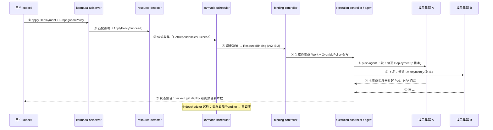

# 一个普通 Deployment 的多集群之旅 —— Karmada 分发全链路

> **前置阅读**: [[18-云厂商/01-阿里云/分布式云-ACKOne/01-ack-one-multi-cluster-architecture.md|ACK One 多集群架构深度剖析]]
> 本文以开源 Karmada 为主线讲透分发链路，最后给出 ACK One Fleet 的差异对照。

---

## 一、大白话一句话

**你把 Deployment 和一份 PropagationPolicy（"铺到哪、每家分几个"）交给 Karmada 控制面，Karmada 按策略把副本切开、打包塞进 Work 对象下发到各个成员集群，各集群自己拉起来，再把状态汇总回去给你看。**

三步记忆：

| 步骤 | 大白话 | Karmada 里发生的事 |
|---|---|---|
| ① 交作业 | 把 Deployment + 策略交给总控台 | apply 到 karmada-apiserver，存进 Karmada 自己的 etcd |
| ② 它分活 | 调度器决定每个集群分几个 | resource-detector 匹配策略 → scheduler 生成 ResourceBinding（副本切分） |
| ③ 各班自己干 | 打包下发，各集群照常运行 | binding-controller 生成 Work → 下发到成员集群，**那里看到的仍是一个最普通的 Deployment** |
| ④ 收成绩单 | 状态汇总回来 | work-status / binding-status 控制器聚合各集群状态 |

---

## 二、前置认知：两个"控制面"和两种接入模式

### 2.1 Karmada 控制面：一套独立的小 K8s

Karmada 控制面 = `karmada-apiserver` + 自己的 etcd + `karmada-scheduler` + `karmada-controller-manager`。它就是一个"以集群为节点"的 K8s：成员集群相当于它的"Node"，`PropagationPolicy` 之于多集群，相当于 `nodeSelector` + 副本数之于单集群调度。

**关键认知：你的 Deployment 从此不再直接 apply 给任何成员集群** —— 它只存在于 Karmada 控制面，作为"资源模板"；真正落到成员集群的是 Karmada 派生的副本。

### 2.2 成员集群接入：push 与 pull

| 模式 | 机制 | 适用 |
|---|---|---|
| **push** | Karmada 控制面直接持有成员集群 kubeconfig，由 execution controller 主动下发 | 集群网络可达（同 VPC/专线），云上集群 |
| **pull** | 成员集群内部署 `karmada-agent`，agent 反向连接控制面、拉取 Work 并在本集群执行 | IDC/边缘/第三方云，控制面无法直连 |

注册集群：`karmadactl join <cluster-name> --cluster-provider=...`；`karmadactl get clusters` 查看状态。ACK One Fleet 的注册集群用的就是 pull 式（agent 反向连接）思路，底座换成 OCM 的 ManagedCluster。

---

## 三、全链路 9 步：一份 Deployment 的完整旅程



逐步拆解（事件名在 Karmada 侧 `kubectl describe` 可见，ACK One Fleet 同名同链路）：

1. **提交**：`kubectl apply`（kubeconfig 指向 karmada-apiserver）。Deployment 和 PropagationPolicy 作为两个普通 API 对象存入 Karmada 的 etcd。此刻它只是一份**模板**，不属于任何集群。
2. **策略匹配（resource-detector）**：监听 API 对象，发现 Deployment 命中 PropagationPolicy 的 `resourceSelectors`，标记"待分发"→ 事件 `ApplyPolicySucceed`。
3. **依赖收集（dependencies-distributor）**：Deployment 引用的 ConfigMap/Secret/Service/ServiceAccount 被一并纳入分发范围（对应策略字段 `propagateDeps: true`）→ `GetDependenciesSucceed`。**漏配依赖是多集群分发的头号翻车点**：Pod 起来了但读不到配置。
4. **调度决策（karmada-scheduler）**：读 Placement（集群亲和、拓扑打散、容忍集群 taint、权重），产出 `ResourceBinding` —— 它记录"这份资源 → {集群A: 2 副本, 集群B: 2 副本}" → `ScheduleBindingSucceed`。**ResourceBinding 是多集群版的"Pod 调度结果"**。
5. **派生 Work + 差异化改写（binding-controller / override-manager）**：为每个目标集群生成 `Work` 对象，把 manifest 打包进 `Work.spec.workload.manifests`；OverridePolicy 在打包前完成改写（换镜像源、加 label、改参数）→ `SyncWorkSucceed` / `ApplyOverridePolicySucceed`。
6. **下发执行**：push 模式由 execution controller 直接 apply 到成员集群；pull 模式由集群内 agent 监听 Work 并在本集群 apply。
7. **成员集群照常运行**：集群自己的 scheduler / kubelet / HPA 接管，**那里没有任何 Karmada 概念**，就是一个 2 副本的普通 Deployment。这是"零侵入"的本质：Karmada 只在上层切活，不动集群内部。
8. **状态聚合**：`work-status-controller` 收 Work 状态 → `resource-binding-status-controller` 汇总 → 你在 Karmada 侧 `kubectl get deployment` 看到的是**聚合后的就绪副本数** → `AggregateStatusSucceed`。
9. **持续巡检与故障迁移（karmada-descheduler）**：监控各集群资源水位与 Pod Pending，副本分布偏离期望时触发重调度 → `DescheduleBindingSucceed`；集群失联时控制面给集群对象打 taint，scheduler 按容忍度把副本迁往健康集群（ACK One 实测约 3 分钟收敛）。

---

## 四、最小可运行 YAML

```yaml
# ① 最普通的 Deployment（不加任何多集群字段）
apiVersion: apps/v1
kind: Deployment
metadata:
  name: echo-server
  namespace: demo
spec:
  replicas: 4
  selector:
    matchLabels: { app: echo-server }
  template:
    metadata:
      labels: { app: echo-server }
    spec:
      containers:
      - name: echo
        image: registry.k8s.io/echoserver:1.10
        ports: [{ containerPort: 8080 }]
---
# ② 分发策略：铺到哪、每家分几个
apiVersion: policy.karmada.io/v1alpha1
kind: PropagationPolicy
metadata:
  name: echo-server-policy
  namespace: demo
spec:
  resourceSelectors:
  - apiVersion: apps/v1
    kind: Deployment
    name: echo-server
  - apiVersion: v1
    kind: Service
    name: echo-server
  propagateDeps: true                    # 连带分发依赖资源
  placement:
    clusterAffinity:
      clusterNames: [cluster-a, cluster-b]
    replicaScheduling:
      replicaSchedulingType: Divided     # 副本切分；Duplicated=每家全量复制
      replicaDivisionPreference: Weighted
      weightPreference:
        dynamicWeight: AvailableReplicas # 动态权重：按各集群实时可用副本容量分
---
# ③ 差异化策略：到集群 B 换内网镜像源
apiVersion: policy.karmada.io/v1alpha1
kind: OverridePolicy
metadata:
  name: echo-server-override
  namespace: demo
spec:
  resourceSelectors:
  - apiVersion: apps/v1
    kind: Deployment
    name: echo-server
  targetCluster:
    clusterNames: [cluster-b]
  overriders:
    plaintext:
    - operator: replace
      path: /spec/template/spec/containers/0/image
      value: registry-vpc.internal/echoserver:1.10
```

---

## 五、四个关键设计点（面试高频追问）

### 5.1 Duplicated vs Divided 怎么选

| 类型 | 语义 | 适用 |
|---|---|---|
| **Duplicated** | 每个集群一份**全量副本** | 无状态入口型服务追求多活容量；ConfigMap/CRD 类"处处都要有"的资源 |
| **Divided** | 总副本数**切分**到各集群 | 成本敏感、按集群容量分配算力；配合多集群 Service/网关做统一入口 |

Divided 的隐含前提：**流量要有人导**。副本切了，但成员集群里的 Service 是各自独立的 VIP——要么叠加多集群网关/Service（ACK One 方案），要么 ClusterMesh 全互联（开源方案），否则切分只是"算力分布"，不是"服务分布"。

### 5.2 成员集群里真的是"普通 Deployment"吗 —— 是，且必须保持

- 集群内没有 Karmada 组件，Helm/Argo/普通 kubectl 在集群内部仍然可用；
- HPA、PodDisruptionBudget、节点自动伸缩全部归集群自治，Karmada 不下沉替代；
- **红线**：绕过控制面直接改成员集群里的 Deployment，会被 Karmada 下一轮 reconcile **覆盖回去**——多集群下的"配置漂移"就是这种手改。反过来，存量应用补一份 PropagationPolicy 提交到控制面即可被**接管（Adoption）**，ACK One 里 `kubectl amc get deploy -M` 的 `ADOPTION=Y` 就是接管标记，接管过程不重启 Pod。

### 5.3 状态聚合是"假象"，要知道它的边界

Karmada 侧 `kubectl get deployment` 的 ready 数是各集群上报的聚合值；但它不等于全局健康——**网络入口不通时副本全绿、服务全挂**。所以多集群健康判定必须叠加入口层探活（多集群网关健康检查 / ASM），这正是 ACK One 把网关做成产品的原因之一。

### 5.4 与 Argo CD ApplicationSet 的本质区别

| | Karmada（PropagationPolicy） | Argo CD ApplicationSet |
|---|---|---|
| 分发单位 | **整份资源，或切分后的副本** | **整份资源**（每个目标集群一份完整渲染结果） |
| 副本级调度 | ✅ Divided/权重/动态重分配 | ❌（要靠每集群 HPA 自己撑） |
| 故障迁移 | ✅ descheduler + taint 驱动 | ❌（靠外层 Global LB/Argo Rollouts） |
| 定位 | 多集群调度内核 | 多集群交付工具 |

一句话：**ApplicationSet 回答"交付到哪些集群"，Karmada 回答"每个集群承担多少、坏了怎么挪"**。两者可叠加：ArgoCD 管 Git→控制面的交付，Karmada 管控制面→成员集群的调度。

---

## 六、ACK One Fleet 上的差异对照

| 维度 | 开源 Karmada | ACK One Fleet |
|---|---|---|
| 控制面 | 自建自维（karmada-apiserver/etcd） | 阿里云托管，KubeConfig 直连 |
| 策略 API 组 | `policy.karmada.io/v1alpha1` | `policy.one.alibabacloud.com/v1alpha1`（**YAML 不能原样迁移**，改 apiVersion 即可） |
| 下发载体 | `work.karmada.io` | `work.one.alibabacloud.com`（OCM 语义） |
| 集群纳管 | karmadactl join / agent | OCM ManagedCluster + 注册集群代理 |
| GitOps | 另装 ArgoCD | Fleet 内置托管 ArgoCD + RAM SSO |
| 多集群 CLI | karmadactl | `kubectl amc`（`-M` 全集群、`-m` 指定集群） |
| 故障迁移 | descheduler + taint | 同链路，实测约 3 分钟收敛 |

在 Fleet 上跑通本文 YAML 只需两处改动：把两个 Policy 的 `apiVersion` 换成 `policy.one.alibabacloud.com/v1alpha1`，kubeconfig 换成 Fleet 的。事件流（`ApplyPolicySucceed` → … → `DescheduleBindingSucceed`）与开源完全同名。

**演进注记**：Fleet 2023 年版本的应用分发用 KubeVela Application（`core.oam.dev/v1beta1` + `topology` 策略），现主推 Karmada 语义的 PropagationPolicy/OverridePolicy。读旧资料时先看 apiVersion 判断时代。

---

## 七、面试问答卡

**一句话**：Deployment + PropagationPolicy 交给 Karmada 控制面 → scheduler 切副本生成 ResourceBinding → 打包成 Work 下发各成员集群 → 集群里照常跑普通 Deployment，状态聚合回来，故障时 descheduler 自动迁移。

**30 秒答**：Karmada 是"以集群为节点"的调度层。第一步把 Deployment 和 PropagationPolicy apply 到 Karmada 控制面，资源只是模板；resource-detector 匹配策略、收集依赖，scheduler 按亲和/权重把副本切分写入 ResourceBinding；binding-controller 为每个目标集群生成 Work 并按 OverridePolicy 改写后下发（push 直连或 agent 拉取）；成员集群用自己的调度器和 HPA 拉起 Pod，Karmada 只做状态聚合和持续巡检，集群故障时打 taint 触发重调度完成 failover。全程对应用零侵入。

**高频追问**：
- 副本怎么分？→ Duplicated 全量复制 / Divided 切分 + 静态权重或 `dynamicWeight: AvailableReplicas` 动态权重。
- 依赖的 ConfigMap 怎么办？→ `propagateDeps: true` 或 dependencies-distributor 自动收集，漏配是头号翻车点。
- 和 Argo CD ApplicationSet 区别？→ 整份交付 vs 副本级调度 + 故障迁移；可叠加。
- 直接改成员集群的资源行不行？→ 行但会被 reconcile 覆盖，多集群下这叫配置漂移；正确姿势是改控制面。
- ACK One 和开源什么关系？→ 托管 + API 组改名 + 补齐托管数据面（网关/多集群 Service），调度链路同名同构。

**红线**：
1. 开源 Karmada YAML 进 ACK One 必须改 apiVersion；
2. Divided 切分后必须配跨集群流量方案，否则是"算力分布"不是"服务分布"；
3. 删除 PropagationPolicy 默认**级联删除**各集群资源，需保留时设置 `preserveResourcesOnDeletion: true`；
4. Work 是内部下发载体，不要手工编辑；
5. 状态聚合全绿 ≠ 服务健康，入口层必须独立探活。

## Related

- [[18-云厂商/01-阿里云/分布式云-ACKOne/01-ack-one-multi-cluster-architecture.md|ACK One 多集群架构深度剖析]]
- [[10-平台工程/02-运维/10-multi-cluster-management.md|多集群管理]]
- [[28-资产/architecture-diagrams/architecture-multi-cluster.md|多集群架构模式]]
- [[11-发布变更/01-GitOps/10-fleet-gitops-operations-guide.md|Fleet GitOps 运维指南]]
