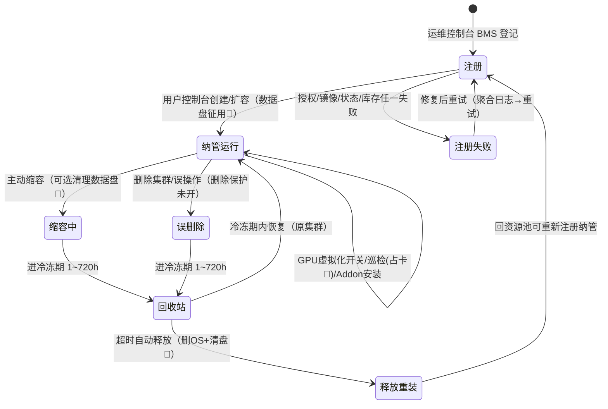

> **阅读定位与口径声明**
>
> 本篇是 009 FAQ 速查层的**深挖层**：009 回答「现象 → 处理」，本篇回答「机制 → 为什么 → 怎么防」。BMCP 产品事实（参数、限制、行为）全部锚定《V3.20.0 BMCP 用户指南/产品介绍》（20260423）经 009 note 核实的内容；凡属基于 K8s/容器本体通用机制做的**机制推断**（如数据盘征用的 kubelet 视角、GPU 生态对照），均在文中显式标注「推断」，供决策参考而非官方口径。涉及数据盘、缩容、释放的操作不可逆——红线以 009 §4 为准，本篇负责把红线背后的机制讲透。

# BMCP 纳管 ACK 容器智算集群 — 纳管机制与生产运维深挖

## 1. 深挖定位：FAQ 层与深挖层的关系

| 层 | 文档 | 回答的问题 | 使用场景 |
|----|------|-----------|---------|
| FAQ 速查层 | [[wiki/18-云厂商/01-阿里云/专有云-ACK/009-bmcp-ack-onboarding-faq.md\|009 纳管 FAQ]] | 现象 → 根因 → 处理 | 出事时按表走查、纳管前 checklist |
| 深挖层（本篇） | 010 | 机制 → 为什么 → 怎么防 | 方案评审、变更预案、面试深追问、故障复盘归因 |

两篇共享同一套源文档口径（V3.20.0，20260423）。本篇新增的所有「判断线」「决策树」「预案模板」都从 009 的官方限制反推而来，不引入未经核实的产品行为。

---

## 2. 纳管架构解剖

### 2.1 三层控制台职责矩阵

BMCP 纳管 ACK 的第一步迷障是「三个控制台各管什么」。职责切错层是创建失败的头号非技术根因：

| 控制台 | 职责 | 纳管链路中的角色 |
|--------|------|-----------------|
| **Apsara Uni-manager 运营控制台** | 全局运营：组织、RAM、计费规则、配额 | 组织级 RAM 双授权在这里做；admin 账号权限不受限，慎用 |
| **BMCP 运维控制台**（裸机管理 BMS） | 裸机生命周期：装机、注册实例、节点状态 | 纳管的**前置闸门**——实例必须先在这里注册且状态正常，否则 BMCP Worker 列表为空（009 速查表 #2） |
| **BMCP 用户控制台** | 集群与节点 > 集群管理 > 容器-智算算力集群 | **纳管动作的执行层**：创建集群、选 Worker、扩缩容、回收站、GPU 虚拟化、巡检 |

**判断线**：节点选不到 → 先查运维控制台注册状态，而不是反复刷新用户控制台；授权报错 → 先查 Uni-manager 组织授权，而不是集群创建页。「创建页报的错，根因常在上一层的控制台」。

```
Apsara Uni-manager（运营：组织/RAM/计费）
     │ 组织级授权
     ▼
BMCP 运维控制台 BMS（裸机：注册/装机/状态）   ← 前置闸门
     │ 实例已注册 + 状态正常
     ▼
BMCP 用户控制台（纳管执行：创建/扩缩/回收站/GPU）
     │ kubeconfig
     ▼
ACK 集群（kubectl 直连 / 跳转 ACK 控制台）
```

### 2.2 RAM 双授权解剖

创建容器-智算算力集群要求**两项**独立授权（009 速查表 #1）：

1. **容器服务 RAM 角色授权** —— 授予 ACK 容器服务操作 BMCP 资源的权限（创建集群时代您操作 Worker）；
2. **云接入网关（CGW）RAM 角色授权** —— 授予云接入网关的接入权限（集群连接与接入链路）。

**为什么是两项而不是一项**（推断）：两项授权对应两条独立的资源操作链——控制面创建链（容器服务要操作 VPC/ECS/BMS）与接入链（CGW 建立集群接入通道）。专有云按产品拆分 RAM 角色，最小权限原则下一条链一个角色。**运维含义**：只授了容器服务角色时，报错会出现在集群创建阶段而非接入阶段；反之亦然。排查时按「授权 → 刷新状态 → 再操作」顺序走，授权后必须点刷新按钮，缓存状态不会自动更新。

### 2.3 Master=ECS / Worker=裸金属 的非对称设计

纳管形态固定 **Master 用 ECS、Worker 可选 ECS 或 BMCP 裸金属**。这个非对称不是随意的：

- **Master 要的是稳定与快速重建**：ECS 规格标准化、系统盘可控（超高速盘/本地 SSD/高性能盘）、故障时秒级替换——控制面 SLA 由云平台机制兜底；
- **Worker 要的是算力**：GPU 裸金属的价值在整机直通（GPU/NVLink/RDMA 网卡不虚拟化损耗），这正是智算裸金属存在的意义；
- **联动约束**：Master 可选规格数 = 所选 vSwitch 数量 N（N ≤ Master 数量，009 速查表 #4）——规格候选按 vSwitch 逐个匹配，多选 vSwitch 就是多给候选池。

**面试口径**：把「为什么 Master 不用裸金属」答成「裸金属太贵」是错的——正解是控制面与数据面的需求错位：控制面要弹性与可替换性（ECS 优势），算力面要整机直通与规模（裸金属优势）。

### 2.4 纳管型的 CHSW / HSW 接入

仅**智算纳管型**实例有 CHSW 接入 / HSW 接入参数（009 §1.3）。纳管型的本质是**利旧**——客户已有 IB/RoCE 网络与存量裸机，BMCP 不重建网络而是接管。接入方式参数就是「接管通道」的选型（推断：对应裸金属管理与数据面的不同接入路径）。**生产含义**：纳管型问题排查要同时看两条网——BMCP 管理面（新接入的）与客户存量 IB/RoCE 数据面（利旧的）；后者 BMCP 只纳管不运营，出问题要走客户原有网络运维通道，不能只在 BMCP 控制台里打转。

---

## 3. 实例规格选型决策树

四形态选错是「常见问题根源」（009 §1.3 原话）。把限制反推成决策树：

```
智算集群要接什么网络？
├─ 已有 IB/RoCE 投资要利旧
│   └─ 智算纳管型（选节点+配镜像；三方存储 iSCSI/NFS；CHSW/HSW）
│       ⚠ 无高性能存储(CPFS/APFS)；无文件备份快照；扩容需额外配可用区（存量实例升级前）
├─ 要原生 RDMA + 高性能并行存储
│   ├─ 训推一体的容器智算
│   │   └─ 智算高网型（RDMA + CPFS/APFS；EVPC 可选）
│   └─ CPN 网络新形态
│       └─ 智算训推优化型（CPN + APFS）
└─ 只要基础容器算力
    └─ 智算基础型（本地盘为主；无高网/高性能存储）
```

**三条判断线**：

1. **存储线**：要 CPFS/APFS → 只有高网型、训推优化型；纳管型选 CPFS 是配置错误（009 红线）。反过来，开了高性能存储的集群**缩容下限 ≥3 节点**（CPFS）——选型时就埋下缩容弹性约束；
2. **备份线**：文件备份快照仅高网型/基础型——纳管型的数据保护要走三方存储自身的备份机制，BMCP 快照帮不了你；
3. **Worker 配置方式线**：纳管型是「选节点 + 配镜像」（圈定具体裸机），其余形态是「选规格 + 配数量」——这决定了纳管型扩容是**逐节点审批式**的，不能像规格型那样批量拉起。

---

## 4. 纳管时节点内部发生了什么

### 4.1 纳管链路五步

```
① BMS 注册（运维控制台登记实例）
     ▼
② 创建时校验（授权/镜像白名单/节点状态/库存）
     ▼
③ 镜像核对与安装（白名单四选一，§4.3）
     ▼
④ 数据盘征用（§4.2，🔴 唯一动数据的环节）
     ▼
⑤ 接管进 ACK（kubelet 注册，节点池纳管）
```

失败最集中在 ②：五类根因（RAM 双授权、镜像白名单、实例未注册/状态异常、Master 规格×vSwitch 联动、CIDR 冲突）——对应 FTA 树见 §6。

### 4.2 数据盘征用机制（🔴 本篇最重要的机制解释）

009 红线 R1 的原文：BMCP 节点已挂数据盘且**最后一块未初始化**时，纳管自动格式化为 ext4，挂载 `/var/lib/docker` 与 `/var/lib/kubelet`。

**机制推断**（用 K8s 本体知识解释「为什么这么设计」）：

- **为什么挂这两个目录**：`/var/lib/docker`（容器读写层与镜像存储）和 `/var/lib/kubelet`（emptyDir/Pod 生命周期卷/容器日志挂载点）是节点磁盘 IO 的大头。系统盘跑 OS、数据盘跑容器运行时，是标准的节点盘布局——纳管时自动完成这个布局是「让裸机即插即用成 K8s 节点」的合理设计；
- **为什么是「最后一块未初始化」盘**：节点初始化逻辑按盘序扫描，把最后一块尚无文件系统的盘征用为运行时盘（推断：无文件系统 = 无存量数据 = 征用最安全，这是「宁可不挂、不能误挂」的保守策略——所以未挂数据盘的节点不会新挂）。**但「未初始化」≠「无价值数据」**：客户裸机上可能有未做文件系统的原始数据区、临时采集区；
- **kubelet 视角的后果**：格式化 = 换掉一块空盘，kubelet 重启后 emptyDir 全空、镜像缓存全空——对纳管前就在跑业务的裸机，等于**无声的数据面清零**；
- **为什么扩容同样触发**：扩容纳管新节点走同一条初始化链路，红线不因「只是加节点」而豁免。

**防御清单（从机制反推）**：

| 时点 | 动作 |
|------|------|
| 纳管前 | `lsblk` 逐盘核对：有无数据盘、最后一块是否未初始化、盘上有无裸数据区 |
| 有数据 | 先备份或明确申报放弃；无法判断时按有数据处理 |
| 无法备份 | 拔盘/换盘后再纳管——未挂数据盘的节点不会被新挂盘 |
| 已纳管才发现 | 数据已被格式化，走备份恢复；无备份则进入事故流程，不要试图「找回」 |

### 4.3 镜像白名单的 why

白名单（009 §3.2）表面是版本列表，底下是三层约束（推断，按 K8s 节点组件兼容性反推）：

| 白名单维度 | 底下约束什么 |
|-----------|-------------|
| 内核 5.10.x（AL3）/ 5.15.x（Ubuntu 22.04 仅纳管型） | eBPF 能力面（CNI/可观测依赖）、容器运行时内核特性、GPU 驱动内核模块编译目标 |
| 架构 AMD64 / ARM64 | 容器镜像架构、GPU 卡型生态（NVIDIA x86 为主 / 国产卡多 ARM）、BMCP 机型 |
| 发行版 AL3 / AL3 Pro / Ubuntu | ACK 节点组件（kubelet/容器运行时/云监控）的适配与测试矩阵 |
| 「仅纳管型」的 Ubuntu | 利旧场景客户已有 Ubuntu 运维体系，纳管型是唯一保留户习惯的形态 |

**运维含义**：白名单外镜像不是「装不上」，是「装上了也不在支持矩阵里」——排障时云侧会直接判外围。纳管型重装镜像走白名单是**强制的**（009 速查表 #3），没有「豁免申请」这类东西。

---

## 5. 节点生命周期状态机

把 009 分散在扩缩容/回收站/红线里的规则，收拢成一张状态机（🔴 标不可逆边）：



**状态机读法（运维含义）**：

1. **恢复窗口只有一个**：回收站冷冻期（1~720 小时，集群级可配）。错过 = 删 OS + 清盘 + 重装，不可逆——所以「节点消失」类事件的**第一动作是确认冷冻期还剩多久**，而不是先查根因；
2. **释放≠销毁**：释放重装后实例回资源池，可以重新注册纳管——硬件没坏，丢的是 OS 与盘上数据。恢复的是「这批算力」，不是「这台节点的现场」；
3. **实例保护不可关是保护**：默认开启且无法变更，防止其他产品经控制台/API 直接删除集群内裸机（009 红线 R6）——把它当故障去关是方向性错误；
4. **删除集群要输入「确认删除」**且仅稳定状态可删——这是最后的人工闸门，自动化脚本里不要绕过这个交互（也绕不过，这正是设计意图）。

**变更预案模板（缩容必填项）**：

```markdown
## BMCP 缩容预案
- 目标节点: <hostname 列表>
- 数据盘处理: □ 已备份  □ 勾选「清理数据盘」(🔴不可逆)
- 高性能存储: □ 本集群启用中 → 缩容后节点数 ≥ 3 (CPFS)/≥ 1 (APFS) 已核对
- 冷冻期配置: 当前 <N> 小时，覆盖本次变更观察窗口 <是/否>
- 回收站恢复责任人: <姓名> （冷冻期内有人盯着恢复窗口）
- 计费/订单: □ 服务订单已确认（BMCP/容器-智算算力集群服务实例已创建→确认订单）
```

---

## 6. 纳管失败 FTA 排障树

009 速查表 #1–#7 的根因收拢成树。**用法**：从「创建失败/节点选不到」出发自上而下走查，每层先查最常见的：

```
纳管失败 / Worker 选不到
├─ A. 授权层（最高频）
│   ├─ 容器服务 RAM 角色未授权 → 组织未授权报错
│   ├─ CGW RAM 角色未授权 → 接入阶段报错
│   └─ 已授权但状态未刷新 → 点刷新按钮
├─ B. 节点层
│   ├─ 实例未在 BMS 注册 → Worker 列表空
│   ├─ 节点状态异常 → 运维控制台查状态
│   └─ 库存不足 → 换可用区/规格
├─ C. 镜像层（纳管型高频）
│   ├─ 架构不符（ARM/x86）
│   ├─ 发行版不在白名单（Ubuntu 仅纳管型）
│   └─ 内核版本不符（5.10.x/5.15.x）
├─ D. 规格与网络层
│   ├─ Master 规格下拉空 → vSwitch 数量不足
│   ├─ K8s 版本不在 {1.32.7-aliyun.1, 1.30.7-aliyun.1}
│   ├─ Pod/Service CIDR 与 VPC/既有集群冲突（创建后不可改）
│   └─ 未配 SNAT → 公网镜像拉不到（创建后可补 NAT 网关）
└─ E. 已创建集群的失败任务
    └─ 操作记录 → 聚合日志 → 下钻子任务 → 重试/诊断
```

**诊断加速器**：D 层以下的失败，不要人肉反复试创建——操作记录的**聚合日志**能下钻到失败子任务，直接**重试**或发起**诊断**（009 §9.1）。E 层是所有创建/扩容失败的标准归因通道。

**节点「消失」三路鉴别**（呼应状态机 §5）：

| 现象 | 鉴别点 | 动作 |
|------|--------|------|
| 节点从集群消失 | 回收站页签有记录 | 冷冻期内恢复（先看剩余时间！） |
| 回收站也没有 | 超时已释放重装 / 从未纳管成功 | 查操作记录与 BMS 注册状态 |
| 集群还在、节点 NotReady | K8s 侧问题 | 走 [[skills/03-节点/node/01-node-notready-diagnosis.md\|节点 NotReady 诊断]]，与 BMCP 侧无关 |

第三路是关键分岔：**K8s 侧的节点故障不是 BMCP 纳管问题**，别在 BMCP 控制台里修 kubelet。

---

## 7. GPU 专项深挖

### 7.1 GPU 虚拟化三路线与卡型矩阵

009 §8.1 的支持矩阵底下是三种隔离路线（推断，按 GPU 虚拟化通用技术反推）：

| 路线 | 隔离位置 | 卡型（009） | 特征 |
|------|---------|------------|------|
| **用户态虚拟化** | 用户态运行时拦截 CUDA 调用 | APG 仅此路线 | 无需硬件支持，隔离强度依赖用户态实现 |
| **内核虚拟化** | 内核态驱动层切分 | 部分 A 系 NVIDIA | 介于两者之间 |
| **硬件虚拟化** | 硬件 SR-IOV 类机制 | 海光 K100-AI/BW1000 仅此路线；部分 A 系 NVIDIA | 隔离最强，开启有硬前提 |

🔴 **硬件虚拟化的「GPU 必须空闲」前提**（009）：开启时 GPU 上有任务即失败。机制推断：硬件虚拟化要重配 GPU 的硬件分区状态，等价于对卡做 reset 级操作——跑着任务的卡当然开不了。**运维含义**：这是排产问题不是技术问题，开硬件虚拟化要走变更窗口（先停任务→再开→再放任务）。

### 7.2 KGPU 架构解剖

KGPU 是 BMCP 的 GPU 共享/虚拟化资源调度（009 §8.2）。K8s 视角拆解：

- **前提链**：集群有 ECS 实例 + 已启用集群运维服务 + 已装 **KGPU 套件 + BMCP GPU Toolkit** + 已启用用户态虚拟化——四件套缺一不可，排查「KGPU 资源不出现」按这条链逐环验；
- **资源模型**：`kgpu.com/gpu-count`、`kgpu.com/gpu-mem`、`kgpu.com/gpu-core.percentage`。调度语义：`gpu-count=0/1` → 调度到一张物理卡（**0 必须搭配其他资源申请**），`>1` → 多张物理卡。这是标准的 extended resource + device plugin 语义（推断），Pod 级申请、调度器过滤；
- **隔离开关**：`kube-system/kgpu-dp` ConfigMap 的 `shareModel`：`0` 关 / `1` 显存隔离 / `3` 显存+算力双隔离（默认）。**修改后需重启 kgpu DaemonSet 生效**——改了 ConfigMap 以为什么都没发生，是高频坑；
- 🔴 **特权容器（privileged）不可用 KGPU**：机制推断——特权容器绕过 device 挂载与隔离层直通硬件，KGPU 的计量隔离对它无效，所以直接禁用。

### 7.3 K8s GPU 共享生态对照

把 KGPU 放进 K8s GPU 生态看（**推断层**，生态事实为开源社区通用知识）：

| 维度 | BMCP KGPU | HAMi | NVIDIA GPU Operator + time-slicing | DRA（K8s 原生） |
|------|-----------|------|-----------------------------------|-----------------|
| 出身 | BMCP 产品内建（专有云） | 开源（CNCF 沙箱，yard/{4paradigm} 起点） | NVIDIA 官方 | K8s 上游（alpha→beta 演进中） |
| 隔离 | 显存 / 显存+算力（shareModel） | 显存硬限制+算力配比 | 仅显存上限（无算力隔离） | 由厂商 driver 模式提供 |
| 适用 | BMCP 纳管集群内开箱即用 | 多厂商异构卡、需要 vGPU 语义的开源栈 | NVIDIA 单厂商、轻共享 | 未来原生方向，生态在落地 |
| 与本库 | 本篇 | [[wiki/15-AI基础设施/05-K8s-AI基础设施/01-gpu-operator-sharing-patterns.md\|GPU Operator/共享模式]] | 同左 | [[wiki/15-AI基础设施/05-K8s-AI基础设施/17-cdi-device-plugin-framework.md\|CDI/DRA 框架]] |

**判断线**：在 BMCP 纳管集群里，**优先 KGPU**——它是平台内建的，监控/巡检/事件监控同源；HAMi/GPU Operator 是「离开 BMCP 生态（多云/自建）」时的等价物。生态对照用于面试（「你们的 GPU 共享怎么做」）与跨云方案评审，不用于在 BMCP 内重复造轮子。

### 7.4 GPU 可观测与告警

- **事件监控**（009 §8.3）：覆盖 GPU PCIE/驱动掉卡、计算引擎异常、PCIE 链路带宽下降、NVLink 故障；严重/警告/提示三级；**回调必须域名不能 IP**；
- **集群监控三维**：基础（CPU/内存/磁盘/TCP/带宽）+ GPU（温度/功率/利用率/编解码器/帧缓存）+ RDMA（收发吞吐、缓冲区溢出数、报文乱序数）；
- **云监控指标空间 `acs_bmcp`**：资源告警跳转云监控报警历史——告警闭环的第二跳在云监控侧，配值班路由时别只配 BMCP 侧；
- **巡检占卡🔴**：含耗时诊断项/压力测试的巡检会占用 GPU——巡检窗口必须与训练/推理业务错峰，这是变更管理不是个人操作习惯（009 速查表 #14）。

---

## 8. 网络两面模型

BMCP 智算集群的网络要拆成**两个正交面**理解（009 §6 的结构化重述）：

```
┌───────────── VPC 面（通用算力网络）─────────────┐
│ VPC/vSwitch · Master/Worker 互通 · Pod CIDR     │
│ Service CIDR · SNAT 公网出口 · API Server EIP   │
│   → 约束: CIDR 创建后不可改; Pod CIDR 不与      │
│     VPC/同VPC既有K8s集群冲突                     │
└─────────────────────────────────────────────────┘
┌───────────── RDMA 面（智算算力网络）─────────────┐
│ EVPC(RDMA 网段/子网管理·集群间RDMA隔离)          │
│ 仅通用智算集群型实例支持; 参数仅高网型/训推优化型 │
│ ECR(裸金属↔高速通道网关绑定) · 通信库管理         │
└─────────────────────────────────────────────────┘
```

**两面正交的运维含义**：

1. **排障分面**：Pod 间东西向不通 → VPC 面（CNI/CIDR/安全组）；训练 collective 通信慢/NCCL 超时 → RDMA 面（EVPC 隔离配置、RDMA 监控的缓冲区溢出/报文乱序计数）。两面的问题、工具、责任人不同；
2. **EVPC 删除是红线条目**（009 R7）：删 EVPC 影响通用智算集群型实例网络——RDMA 面的「清理」动作会波及数据面训练任务，与 VPC 面删子网的直觉不同；
3. **纳管型只有 VPC 面**：利旧 IB/RoCE 在客户存量网里，BMCP 的 RDMA 面管理（EVPC/ECR/通信库）不覆盖它——纳管型的 RDMA 故障走客户网络运维通道（呼应 §2.4）；
4. **高网型的 RDMA 可观测入口在集群监控**：收发吞吐/缓冲区溢出数/报文乱序数——这三个计数器是 RDMA 面健康的第一证据，异常先于业务报错出现。

---

## 9. 存储栈分层

### 9.1 三层存储栈

```
┌ 层3: 文件备份（快照）——仅高网/基础型; 依赖专有云内网 OSS
├ 层2: 高性能存储 CPFS/APFS——仅高网/训推型; BMCP 部署并行文件客户端
│       CPFS ≥3 节点 / APFS ≥1 节点; 缩容下限联动
└ 层1: 节点盘——数据盘征用(/var/lib/docker+kubelet)·本地盘(基础型)
        三方存储 iSCSI/NFS/直接挂载——仅纳管型(集群级+节点级)
```

**控制面边界（推断+009 交叉）**：高性能存储的**并行文件客户端由 BMCP 部署**——这意味着存储客户端的生命周期（安装/升级/卸载）在 BMCP 控制台走，不在 ACK 内用 CSI 语义管理。卸载高性能存储会**终止集群内所有使用该文件系统的进程**（009 R5）——这是平台级动作，不是 `kubectl delete pvc` 级别；停用会默认卸载全部挂载。**判断线**：存放在 CPFS/APFS 的训练数据/checkpoint，其可用性承诺由 BMCP 存储专项背书，ACK 侧 PV/PVC 只是挂载面——容量规划与缩容约束（≥3 节点）要在 BMCP 存储专项评审，K8s 存储域知识在此只覆盖挂载语义。

### 9.2 文件备份的专有云 OSS 约束

快照备份仓库依赖 OSS bucket：**公共读写 + 全部用户完全控制 + HTTP 访问**（009 §7.3）。专有云外视角看这是吓人的权限配置，但这是**专有云内网 OSS** 的既有约束（无公网鉴权链路，权限模型按内网语义工作）。**生产含义**：不要用这套 bucket 存敏感于内网访客的数据——它按设计是「内网人人可读」；敏感数据备份走专有云其他加密备份通道或盘古存储专项（[[wiki/18-云厂商/01-阿里云/专有云-ACK/008-apsara-pangu-storage-troubleshooting.md\|盘古存储排障]]）。

---

## 10. 与公云 ACK 差异对照

有公云 ACK 经验的工程师上专有云，最容易带着错误直觉操作。差异收拢成表：

| 维度 | 公云 ACK | BMCP 纳管 ACK（专有云） |
|------|---------|------------------------|
| K8s 版本 | 跟随公云版本策略，多个 minor 可选 | **锁死两个**：1.32.7-aliyun.1 / 1.30.7-aliyun.1 |
| 节点池 | ACK 控制台/ESS 全托管 | **BMCP 侧管**：节点注册/镜像/数据盘在 BMCP 语义下 |
| Master 形态 | 托管版 Pro 为主 | ECS 自管 Master（3/5 节点） |
| 实例保护 | 节点可按需释放 | **默认开启且不可关**（防其他产品释放裸机） |
| 删除保护 | 控制台开关 | 开关 + 删除输入「确认删除」+ 仅稳定态可删 |
| 计费 | 按量/包年包月透明 | 由运营中心配置计费规则才显示（租户可能不可见） |
| 误删兜底 | 节点池重建 | **回收站冷冻期** 1~720h，过期删 OS 重装 |
| GPU 共享 | 公云 ACK GPU 分享方案 | **KGPU**（BMCP 内建，shareModel 隔离） |
| 审计 | SLS 开箱 | 创建时勾选日志服务，Project `k8s-log-{ClusterID}` |
| RAM | 公云 RAM 产品化 | **双授权**（容器服务 + CGW）且授权后需手动刷新 |

**记忆锚**：专有云的本质差异是「**管控面在客户机房**」——所有公云上平台兜底的动作（重建节点、自动授权、版本策略），专有云上变成客户可见的显式流程（冷冻期、双授权刷新、版本锁）。

---

## 11. 生产运维 SOP

### 11.1 变更窗口三查（每次扩缩容/巡检/GPU 虚拟化操作前）

1. **数据盘查**：目标节点最后一块未初始化盘上有无数据（§4.2 防御清单）；
2. **业务占用查**：GPU 操作（虚拟化开启/巡检压测）→ 目标 GPU 空闲 + 业务错峰；
3. **恢复通道查**：缩容/删除 → 冷冻期配置覆盖观察窗口 + 回收站恢复责任人到位。

### 11.2 审计与证据留存

- 操作日志默认**仅 7 天**（009 §9.1）——需审计留存的团队，上线第一周就让管理员改「日志转存设置」，**延长不补历史**，出事后改已经晚了；
- 事件监控报警回调必须域名（不能 IP）——配值班集成时先验回调可达；
- 失败操作的归因证据链：操作记录 → 聚合日志（下钻子任务）→ 诊断报告——这条链产出的证据才被 BMCP 支持，截屏控制台不算。

### 11.3 与 K8s 侧的分工边界

| 症状 | 归属 | 处理入口 |
|------|------|---------|
| 节点消失/创建失败/扩缩容报错 | **BMCP 面** | 操作记录聚合日志 + 本篇 §6 FTA |
| Pod 调度失败/NotReady/服务异常 | **K8s 面** | 节点 NotReady 诊断、[[wiki/19-故障诊断/06-FTA故障树/list/node-fta.md\|node-fta]] 等 K8s FTA |
| GPU 硬件级异常（掉卡/NVLink/PCIE） | **BMCP 事件监控 + BMC/IPMI** | 事件监控定位硬件 → [[wiki/17-系统基础/02-硬件/10-hardware-troubleshooting-methodology.md\|硬件排障方法论]] |
| 双 CCM/云资源所有权冲突 | **K8s 控制面** | [[wiki/01-集群基础/03-控制平面/43-dual-cloud-controller-coexistence-deep-dive.md\|双 CCM 分域共治深挖]]（其 SOFA 侧「BMCP 节点接入器」即本篇纳管链路的 K8s 侧映像） |

---

## 12. 面试口径

本主题的快问快答沉淀在主沉淀文件 **Q128–Q138**（迁移自 009 §11 六张 + 本篇新增五张深挖卡）：

- Q128 纳管形态总览 · Q129 创建失败五类 · Q130 数据盘征用红线 · Q131 纳管型存储限制 · Q132 GPU 智算运维能力与坑 · Q133 BMCP 排查标准动作（以上迁移自 009）
- Q134 BMCP vs 公云 ACK 差异面 · Q135 数据盘征用机制深挖 · Q136 KGPU×GPU 共享生态对照 · Q137 节点消失生命周期状态机 · Q138 VPC/RDMA 两面网络模型（本篇新增）

**追问防线**（面试官往深处打的三个方向）：

1. 「数据盘为什么会被征用」→ §4.2 机制链（运行时盘布局 + 最后一块未初始化的保守策略）；
2. 「KGPU 和 HAMi 什么关系」→ §7.3 对照表 + 「平台内建优先，跨云才选开源栈」判断线；
3. 「缩容会不会丢数据」→ 状态机 §5 + 冷冻期恢复窗口 + 「恢复算力不恢复现场」的精确表述。

---

## 相关文档

- [[wiki/18-云厂商/01-阿里云/专有云-ACK/009-bmcp-ack-onboarding-faq.md|BMCP 纳管 ACK FAQ（速查层）]]
- [[wiki/18-云厂商/01-阿里云/专有云-ACK/alicloud-apsara-ack-overview.md|专有版 ACK 概述]]
- [[wiki/18-云厂商/01-阿里云/专有云-ACK/008-apsara-pangu-storage-troubleshooting.md|盘古存储排障]]
- [[wiki/18-云厂商/01-阿里云/专有云-ACK/005-apsara-tianji-aso-operations.md|天基/ASO 运维流程]]
- [[wiki/01-集群基础/03-控制平面/43-dual-cloud-controller-coexistence-deep-dive.md|双 CCM 分域共治深挖（BMCP 节点接入器的 K8s 侧映像）]]
- [[wiki/17-系统基础/02-硬件/10-hardware-troubleshooting-methodology.md|硬件排障方法论]]
- [[wiki/15-AI基础设施/05-K8s-AI基础设施/01-gpu-operator-sharing-patterns.md|GPU Operator 与共享模式（生态对照）]]
- [[skills/03-节点/node/01-node-notready-diagnosis.md|节点 NotReady 诊断]]

## Sources

- 阿里云专有云 V3.20.0 裸金属算力平台（BMCP）用户指南（20260423，apsarastackdocument OSS；经 009 note 核实抽取）
- 阿里云专有云 V3.20.0 裸金属算力平台（BMCP）产品介绍（20260423，apsarastackdocument OSS；经 009 note 核实抽取）
- 机制推断层：K8s kubelet/运行时数据目录约定、GPU device plugin 与 extended resource 语义、GPU 虚拟化通用技术路线（文中已逐处标注）
