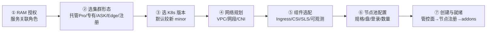
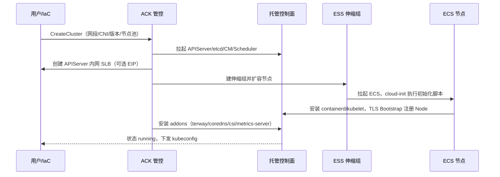
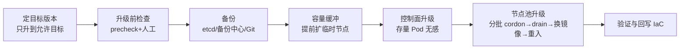

# ACK 集群生命周期：新建流程、升级流程与升级排障

> 一句话定位：**新建的考点是"哪些建完就改不了"，升级的考点是"单向门 + 两阶段顺序"，排障的考点是"先暂停任务，再分清排不出去还是落不下来"。**
> 面试快问快答对应 [[maintaining/04-报告/k8s-高级面试快问快答-沉淀.md|快问快答 Q106–Q108]]。

## 1. 生命周期总览与"不可改清单"

集群生命周期：**规划 → 新建 → 日常运维（节点池/伸缩/组件）→ 升级 → 退役**。本文覆盖首尾两段；中段的节点池管理与弹性伸缩见 [[wiki/18-云厂商/01-阿里云/公有云-ACK/07-ack-node-pool-management.md|节点池管理笔记]]。

**不可改清单**（新建时必须一次定对，改不了只能迁集群）：

| 项 | 创建后 | 说明 |
|---|---|---|
| CNI（Terway / Flannel） | ❌ 不可切换 | 网络插件选定即固化 |
| 所属 VPC | ❌ 不可更换 | 跨 VPC 只能重建集群 |
| Service CIDR | ❌ 不可修改 | 且不可与 VPC/Pod 网段重叠 |
| Pod CIDR（Flannel 模式） | ❌ 不可修改 | Flannel 独立 Pod 网段 |
| Terway IPvlan 模式 | ❌ 不可切换 | 见 Terway 五模式选型 |
| K8s 版本 | ⬆️ 只可升不可降 | 单向门（§7） |
| 集群形态（托管/专有） | ⚠️ 不可直接改 | 专有版走官方迁移路径迁托管 Pro |
| Pod vSwitch（Terway） | ✅ 可追加 | 已用尽的不可删 |
| 节点池 / 组件 | ✅ 可增删、可单独升级 | 组件升级与集群版本解耦 |

## 2. 新建流程（七阶段）



### 2.1 阶段①：前置授权与配额

- 首次开通 ACK 需完成 RAM 授权，创建一组**服务关联角色**（AliyunCSDefaultRole、AliyunCSManagedKubernetesRole、AliyunCSManagedNetworkRole、AliyunCSManagedCsiRole、AliyunCSManagedLogRole、AliyunCSManagedAutoScalerRole 等），分别授权管控面操作 ECS/ENI/SLB/NAS/SLS。
- 配额预检：ECS 实例配额、**ENI 配额**（Terway 密度的硬上限）、vSwitch 剩余 IP、SLB 配额（APIServer 挂 SLB）。
- 生产集群一律走 IaC（Terraform `alicloud_cs_managed_kubernetes` / ROS），版本号、网段、标签全部进代码。

### 2.2 阶段②：集群形态选型

| 形态 | Master | 节点 | 典型场景 | 备注 |
|---|---|---|---|---|
| **托管版 Pro** | 阿里云托管（SLA 99.95%） | 自建节点池 / 虚拟节点 | 生产默认答案 | 管控面收费，Master 免运维 |
| 专有版 Dedicated | 客户自管（3 台 Master ECS + 自管 etcd） | 自建 | 金融强合规存量 | **已停止演进**，官方提供迁托管 Pro 路径 |
| ACK Serverless（ASK） | 托管 | 无节点，全 ECI | 突发/批处理/小集群 | 按 Pod 计费，无节点运维 |
| ACK Edge | 托管 | 边缘节点 | 云边协同 | 边缘自治 |
| 注册集群 | 外部集群自有 | 外部 | 多云/IDC 纳管（ACK One fleet） | 只纳管不迁移 |

一句话记住托管 vs 专有：**Master 谁养——养 etcd 的活归谁**。

### 2.3 阶段③：版本选择

- ACK 同时维护最近若干个 minor 版本，每个版本有维护窗口；窗口外的版本不再提供新建与补丁。
- 新集群**选控制台默认的较新 minor**（版本号形如 `1.32.1-aliyun.1`），不要为"求稳"选老版本——老版本建出来不久就得升（§4.1）。

### 2.4 阶段④：网络规划（新建环节权重最高）

三条网段 + 一个 CNI，全部**创建时定死**：

| 网段 | 规划要点 |
|---|---|
| VPC | 推荐 /16 级别一次给足；与 IDC/办公网互联（CEN/VPN）时避开对端网段 |
| 节点 vSwitch | ≥2 个 AZ（建议 3），每 AZ 一个；按节点终态数留 IP |
| Pod（Terway ENIIP） | **独立 Pod vSwitch**，不与节点混用；容量按 `节点数 × 每节点 Pod 数 × 1.2` 倒推，公式见 Q23 |
| Pod CIDR（Flannel） | 独立网段如 `172.20.0.0/16`；`node_cidr_mask` 决定单节点 Pod 上限——/16 拆 /25 每节点 128 IP，集群上限 512 节点 |
| Service CIDR | 独立不重叠，推荐 /20（4096 个 Service IP），ACK 默认 `172.21.0.0/20` |

- CNI：Terway（推荐，Pod 直连 VPC 无 Overlay）/ Flannel（兼容过渡）；Terway ENIIP 模式为生产默认，模式对比详见 [[wiki/18-云厂商/01-阿里云/公有云-ACK/03-Terway-CNI网络.md|Terway CNI 网络]]。
- APIServer 访问：默认内网 SLB；公网访问（绑 EIP）可事后开关，不影响"不可改清单"。
- Pod 访问公网：需 NAT 网关 + SNAT 条目，建集群时一并勾选或后补。

### 2.5 阶段⑤：组件选配

Ingress（Nginx Ingress / ALB Ingress 二选一，可并存多套）、存储 CSI（云盘/NAS/OSS）、日志（logtail-ds → SLS）、可观测（metrics-server、托管 Prometheus）、安全组件、事件中心（node-problem-detector）、DNS 增强（NodeLocal DNSCache，可选）、虚拟节点（ECI 弹性，可选）。

### 2.6 阶段⑥：节点池初始配置

- 默认节点池：实例规格（**多选备选规格**提升扩容成功率）、系统盘 ESSD、数据盘挂 `/var/lib/containerd`、登录方式（密钥对）、安全组、标签/污点。
- OS：Alibaba Cloud Linux 3 为默认；对安全敏感场景可评估 ContainerOS（最小攻击面）。
- Runtime：containerd（1.24+ 无 dockershim，不要再说"装 docker"）。
- 也可**仅创建管控面**（不配节点），之后再按业务域挂节点池——管控面与计算解耦是托管版的核心卖点。

### 2.7 阶段⑦：创建到就绪的链路



节点注册链路（排障时从后往前查）：**ESS 拉起实例 → cloud-init 初始化 → kubelet TLS Bootstrap 注册 → Node Ready**。

## 3. 创建后生产基线

1. RBAC 授权（子账号按命名空间授权）+ RRSA（应用免 AK 访问云 API）。
2. 节点池按业务域拆分（系统节点池 / 业务节点池 / GPU 节点池），打标签与污点。
3. 基线加固扫描（ACK 基线检查，CIS 基准）。
4. SLS 日志与告警、事件中心、托管 Prometheus 告警规则。
5. 开启备份中心（应用备份 + etcd 由托管面自动快照）。
6. 复核 ENI/ECS 配额，配置余量告警（Terway IP 耗尽是最高频生产事故之一）。

## 4. 升级流程



**顺序铁律：控制面先升、节点池后升；全程单向，没有回滚。**

### 4.1 版本策略

- 控制台/OpenAPI 只返回**允许的目标版本**，不能任选中间版本；老集群可能需要多轮逐级升到位。
- kubelet 允许短暂落后控制面（社区 skew 规则最多落后 3 个 minor），这是"先控制面后节点"的版本依据。
- 常年不升的代价：出维护窗口 → 不再有补丁 → 最后被迫大跨度升级，风险反而更高。生产建议保持 N-1 以内。

### 4.2 升级前检查清单

| 检查项 | 怎么查 | 不过的后果 |
|---|---|---|
| 废弃/移除 API | ACK 集群检查（废弃 API 检测，基于审计日志）；`kubectl get --raw /metrics \| grep apiserver_requested_deprecated_apis`；kubent/pluto 扫清单 | 升级后 apply 失败、旧 Controller 失效（1.25 移除 PSP 是经典事故源） |
| 组件兼容 | Terway/CSI/CoreDNS/Ingress 与目标版本兼容矩阵；**先在组件管理单独升组件**（与集群版本解耦） | Pod 起不来、网络/存储中断 |
| 节点健康 | `kubectl get nodes` 全 Ready；磁盘/inode 余量；containerd 正常 | 升级任务卡住 |
| Webhook | `failurePolicy: Fail` 的 webhook 后端是否高可用、是否可能恰好落在被 drain 的节点上 | 自锁：drain/建 Pod 全被拒 |
| PDB | `kubectl get pdb -A` 看 ALLOWED DISRUPTIONS > 0 | drain 卡死（§5） |
| 容量与 IP | 节点池 requests 余量 ≥ 一批节点的承载量；Terway IP 余量 | 排出来的 Pod Pending |
| 裸 Pod / 单副本 | 列出无控制器 Pod、replicas=1 的关键服务 | 驱逐需 --force / 服务中断 |
| 专有版额外项 | etcd endpoint health、管控面证书有效期 | 控制面升级失败 |
| 配额 | ECS/ENI/SLB 余量 | 新节点起不来 |

### 4.3 备份

etcd 快照（托管版阿里云自动备份；专有版自管必须手动确认）+ 备份中心应用备份 + 关键清单在 Git（GitOps 集群天然满足）。**备份是单向门下唯一的"后悔药"，但它是灾难恢复不是回滚**（§7）。

### 4.4 容量缓冲

预留调度容量 ≈ **并行升级节点数 × 单节点承载**（按该节点池 Pod 的 requests 之和估算）。落地方式：升级前给节点池临时 +N 台，或使用节点池升级配置的 surge 附加节点；升级完成后回收。

### 4.5 执行：两阶段

**控制面阶段**（托管版）：阿里云滚动升级 APIServer/CM/Scheduler/etcd——多副本逐个替换，**存量 Pod 完全无感**；API 有短暂连接重置，客户端 informer 自动重连；窗口内**暂停 CI/CD 发版**。专有版：同样由 ACK 管控任务代升 Master，但 etcd 备份与证书自检责任在客户。

**节点池阶段**：

- 顺序：系统节点池（addons 所在）→ 业务节点池；或直接**蓝绿**——建新版本节点池迁移后删旧池（见 [[wiki/18-云厂商/01-阿里云/公有云-ACK/07-ack-node-pool-management.md|节点池管理笔记]] §8）。
- 每台节点：cordon → drain（Eviction API，受 PDB 保护，走优雅终止）→ 二选一 → 重入集群：
  - **替换系统盘**（默认）：换新 OS + 组件镜像，干净彻底，节点本地盘数据归零；
  - **原地升级**：只升 kubelet/containerd，不换盘、保留节点本地数据，速度快但不刷 OS。
- 批次控制：升级配置支持并行数（max_parallelism）、surge 附加节点、max_unavailable；任务支持**暂停/继续/重试**——排障第一步永远是暂停（§5）。

### 4.6 升级后验证与 IaC 回写

1. `kubectl get nodes -o wide` 版本一致；`kubectl get pods -n kube-system` 全 Running。
2. 组件版本核对（Terway/CSI 已随集群升到位）；`kubectl get events -A --sort-by=.lastTimestamp` 无异常刷屏。
3. 业务拨测 / 黄金指标观察 15–30 分钟（错误率、P99、连接重建）。
4. **回写 IaC**：更新 Terraform/ROS 里的 `version` 字段，`plan` 应无 diff——否则下次 apply 冒出非预期变更。
5. 更新 CMDB/文档，做升级复盘（precheck 漏项、耗时、批次参数是否合理）。

## 5. 升级排障：卡住场景表

> 总原则：**先暂停升级任务止损，再分清"排不出去"还是"落不下来"**；控制面阶段失败只有重试/工单，没有回退。

| 现象 | 根因 | 定位 | 处置 |
|---|---|---|---|
| drain 卡住：PDB 阻塞 | ALLOWED DISRUPTIONS = 0（单副本却写 minAvailable=1；或 Pod 不 Ready） | `kubectl get pdb -A`；`kubectl describe pdb` | 先扩副本 / 临时放宽 PDB / 修 Pod Ready；最常见自锁：StatefulSet 单副本 + minAvailable=1 |
| drain 卡住：webhook 拒绝 | Fail-closed webhook 拦 `pods/eviction`，或后端恰在被 drain 的节点上 | `kubectl get validatingwebhookconfigurations,mutatingwebhookconfigurations -o yaml \| grep -B5 -A5 'failurePolicy: Fail'`；events 里 `failed calling webhook` | 临时 failurePolicy=Ignore（改完改回）/ 先给 webhook 后端加 PDB+反亲和 |
| drain 报 emptyDir | Pod 挂本地 emptyDir | drain 报错信息明确列出 | 确认数据可丢后 `--delete-emptydir-data` |
| drain 报裸 Pod | 无控制器管理 | drain 报错信息 | 确认后 `--force`，或先补控制器；⚠️ --force 会删掉无主 Pod |
| 驱逐后 Pod Pending：容量 | requests 无处安放 | `kubectl describe pod` → Insufficient cpu/memory | 扩临时节点 / 调大 surge（Q41 信号咬合） |
| 驱逐后 Pod Pending：IP | Terway IP 耗尽 | events `allocate ip failed`；`terway-cli show` | 加 Pod vSwitch（详见 Q24 排障） |
| 驱逐后 Pod Pending：调度约束 | 新节点标签/污点与旧节点不一致 | `kubectl describe pod` 调度失败原因 | 校正节点池标签/污点/容忍 |
| 新节点 NotReady 注册不上 | 初始化脚本/镜像/网络/配额 | ECS 系统日志、kubelet 日志、`kubectl describe node` events | 修复后重试；持续异常节点移出节点池 |
| 升级后 Pod CrashLoop | 组件与新版不兼容（Terway/CSI 旧版本） | `kubectl logs` | 补升组件版本 |
| 升级后 apply 报 no matches for kind | API 版本被移除 | 报错资源清单 | 改 apiVersion（如 PSP→PSA） |
| 任务整体超时 | 单节点 drain 超时拖住批次 | 任务详情定位卡住的节点 | 暂停 → 按"排不出去"分支处理 → 继续 |

``` bash
# 🟠 高危：--force 绕过 PDB 与优雅终止，有状态服务可能数据不一致
# 仅在确认 Pod 无状态或数据可丢后使用
kubectl drain <node> --ignore-daemonsets --delete-emptydir-data --force --grace-period=0
```

## 6. 节点池滚动升级 vs Deployment 滚动更新

| 维度 | Deployment 滚动更新 | 节点池滚动升级 |
|---|---|---|
| 滚动单位 | Pod | 节点（先驱逐全部 Pod 再重置） |
| 并发控制 | maxSurge / maxUnavailable | surge 附加节点 / max_unavailable / max_parallelism |
| 可用性保护 | readinessProbe 挡流量 | **PDB 挡驱逐** |
| 优雅终止 | preStop + terminationGracePeriod | drain → Eviction API → 同一套优雅终止 |
| 可暂停 | rollout pause | 任务暂停/继续 |
| 失败行为 | progressDeadline 停滞 | 任务失败等待人工 |
| 回滚 | `rollout undo`（历史 RS 兜底） | **无**：已升节点不回退，控制面不可降级 |
| Surge 成本 | 多起几个 Pod | 多起几台节点（真金白银） |

核心洞察：节点升级对 Pod 而言是**节点故障的受控重演**——应用必须本来就能容忍节点丢失（多副本 + 反亲和 + PDB + 优雅终止），升级才能平滑。**升级季就是应用高可用设计的年度体检**。

## 7. 为什么不可回滚（单向门机理）

- **etcd 里的数据只进不退**：apiserver 把对象按当前 storage version 序列化写入 etcd；升级后新版本可能引入新字段/新枚举，降级后的 apiserver 无法解码或会丢字段——K8s 官方从不支持 apiserver 降级。
- **控制面组件与数据强耦合**：APIServer/CM/Scheduler 读写的正是这份"新格式"数据，旧二进制 + 新数据 = 未定义行为。
- **节点侧其实"可逆"**：kubelet/containerd 可以重装旧版（受 skew 限制不能新于控制面）——所以单向门卡在**控制面 + 数据**，不在节点。
- **所谓的"回滚"只有一条路**：从 etcd 快照恢复到旧版本控制面（专有版自建可做；托管版走工单）——数据回到备份时刻，丢失其后所有写入。这是**灾难恢复，不是回滚**。
- 对比 Deployment：它有 ReplicaSet 历史可切模板，控制面没有"旧模板"可切。所以生产纪律是**前向修复**：备份 + 低峰 + precheck 铁三角，出问题在升级后版本上修复。

## 8. 命令速查

```bash
# ── 创建/查询（aliyun cs CLI，路径以 OpenAPI 门户为准）──
aliyun cs POST /clusters --body '{...}'              # 创建集群（§2 七阶段参数）
aliyun cs GET  /clusters/<id>                        # 详情：current_version / 可升级目标
aliyun cs GET  /clusters/<id>/nodepools              # 节点池列表
aliyun cs POST /clusters/<id>/nodepools/<np>/upgrade --body '{"upgrade_config":{...}}'
                                                     # 节点池升级（surge/max_unavailable/drain_node）

# ── 升级任务 ──
aliyun cs GET  /clusters/<id>/upgrade_status         # 升级状态/进度
aliyun cs POST /clusters/<id>/upgrade --body '{"version":"1.33.1-aliyun-1"}'   # 发起升级
# OpenAPI 对应：UpgradeCluster / GetUpgradeStatus / PauseClusterUpgrade /
#               ResumeUpgradeCluster / CancelClusterUpgrade / UpgradeClusterNodepool /
#               RunClusterCheck（升级前集群检查）

# ── 升级前人工检查 ──
kubectl get nodes -o wide                            # 节点健康与版本
kubectl get pdb -A                                   # PDB 允许中断数
kubectl get --raw /metrics | grep apiserver_requested_deprecated_apis   # 在用废弃 API
kubectl get validatingwebhookconfigurations,mutatingwebhookconfigurations -o yaml \
  | grep -B5 -A5 'failurePolicy: Fail'               # Fail-closed webhook
kubent                                               # 废弃 API 静态扫描（kubent/pluto）

# ── 排障 ──
kubectl drain <node> --dry-run=server --ignore-daemonsets --delete-emptydir-data  # 演练
kubectl get events -A --sort-by=.lastTimestamp | grep -iE "evict|disruption|drain"
kubectl exec -n kube-system ds/terway-daemon -- terway-cli show                  # IP 余量
```

## 9. 面试卡映射

| 卡 | 主题 | 对应章节 |
|---|---|---|
| Q106 | 新建流程 + 不可改清单 | §1–§3 |
| Q107 | 升级流程 + 单向门 | §4、§7 |
| Q108 | 升级排障（排不出去/落不下来/任务失败） | §5 |

关联既有卡：Q22（Terway 五模式 / IPvlan 不可切）、Q23（单节点 Pod 容量公式）、Q24（Terway IP 分配失败排障）、Q34（优雅终止）、Q38（节点加入链路）、Q41（Pending 信号）。

## 10. 相关文档

- [[wiki/18-云厂商/01-阿里云/公有云-ACK/07-ack-node-pool-management.md|ACK 节点池管理与弹性伸缩策略]]
- [[wiki/18-云厂商/01-阿里云/公有云-ACK/03-Terway-CNI网络.md|Terway CNI 网络]]
- [[wiki/18-云厂商/01-阿里云/公有云-ACK/004-ack-vpc-network.md|ACK VPC 网络]]
- [[wiki/18-云厂商/01-阿里云/公有云-ACK/005-ack-ram-authorization.md|ACK RAM 授权]]
- [[wiki/18-云厂商/01-阿里云/公有云-ACK/006-ack-ros-iac.md|ACK ROS IaC]]
- [[wiki/18-云厂商/01-阿里云/公有云-ACK/01-alicloud-ack-production-runbook.md|ACK 生产运维 Runbook]]
- [[wiki/18-云厂商/01-阿里云/公有云-ACK/02-ACK集群运维.md|ACK 集群运维（专有版视角）]]
- [[wiki/18-云厂商/01-阿里云/专有云-ACK/006-apsara-upgrade-patch-management.md|专有云升级与补丁管理]]
- [[wiki/23-实体/02-K8s核心组件/etcd.md|etcd]]
- [[maintaining/04-报告/k8s-高级面试快问快答-沉淀.md|快问快答沉淀文件（Q106–Q108）]]

*具体可升级版本、API 路径与组件兼容矩阵以阿里云官方文档 / OpenAPI 门户为准。*
