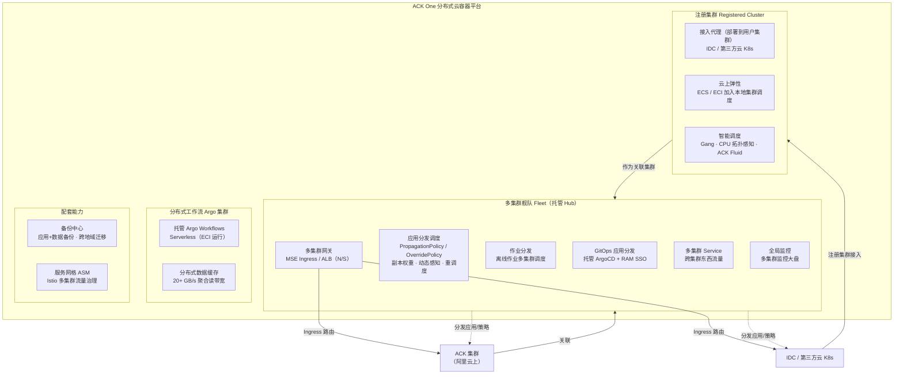
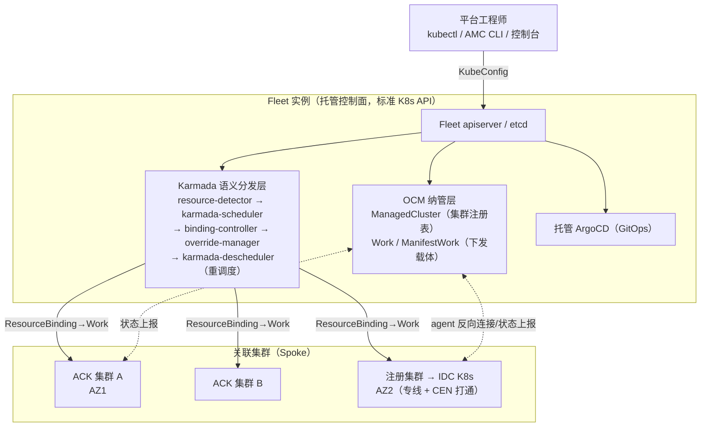
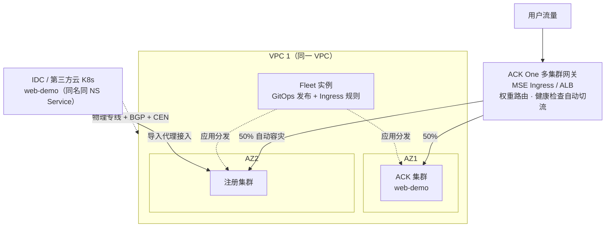

> **生产环境安全提示**
>
> 本文档包含可直接执行的运维命令。执行前请确认：当前目标集群与 Namespace 是否正确；是否具备足够的 RBAC 权限（Fleet 实例建议使用 AliyunAdcpFullAccess 授权的 RAM 用户）；是否已在非生产环境验证。命令风险等级标注：🔴 高风险（可能造成数据丢失或服务中断）、🟡 中风险（会修改集群状态，但通常可回滚）、🟢 低风险（只读/信息收集，无副作用）。

# ACK One 多集群架构深度剖析

> **适用版本**: ACK One（Distributed Cloud Container Platform for Kubernetes），文档事实核对于 2026-10，以官方文档 2026-08-11 更新版为基准
> **难度**: 高级
> **前置阅读**: [[wiki/27-资产/architecture-diagrams/architecture-multi-cluster.md|多集群架构模式（Hub-Spoke / Federation / Mesh）]]、[[wiki/20-最佳实践/09-large-scale-production/10-multi-cluster.md|多集群与联邦管理最佳实践]]

---

## 📋 目录

- [一、结论先行：ACK One 用的是哪种多集群架构](#一结论先行ack-one-用的是哪种多集群架构)
- [二、前置定位：从单集群控制面与网络模型到多集群](#二前置定位从单集群控制面与网络模型到多集群)
- [三、ACK One 产品族全景](#三ack-one-产品族全景)
- [四、Fleet 实例架构深度剖析](#四fleet-实例架构深度剖析)
- [五、多集群应用分发链路：Karmada 内核](#五多集群应用分发链路karmada-内核)
- [六、多集群流量架构：N/S 网关 + E/W Service + ASM](#六多集群流量架构ns-网关--ew-service--asm)
- [七、混合云接入与弹性：注册集群](#七混合云接入与弹性注册集群)
- [八、容灾架构模式：同城双活与两地三中心](#八容灾架构模式同城双活与两地三中心)
- [九、分布式计算：Argo 工作流集群与多集群作业分发](#九分布式计算argo-工作流集群与多集群作业分发)
- [十、与自建方案对比](#十与自建方案对比)
- [十一、选型建议与常见误区](#十一选型建议与常见误区)
- [十二、参考链接](#十二参考链接)

---

## 一、结论先行：ACK One 用的是哪种多集群架构

**ACK One 不是单一模式，而是一个"三层组合"**：以 **Hub-Spoke 为骨架**、以 **Federation（Karmada 语义）为调度内核**、以 **托管云产品为数据面**。

| 层 | 对应经典模式 | ACK One 实现 | 开源底座 |
|---|---|---|---|
| 管理面（集群纳管） | **Hub-Spoke** | Fleet 主控实例（Hub，阿里云托管）+ 关联集群（Spoke，含 ACK 集群与注册集群） | **Open Cluster Management（OCM）**：`ManagedCluster`/`Work` CRD 纳管与工作负载下发 |
| 调度面（应用分发） | **Federation** | `PropagationPolicy`/`OverridePolicy`/`ResourceBinding`，副本权重调度、动态资源感知、重调度、故障迁移 | **Karmada**：事件流中可见 `karmada-scheduler`/`karmada-descheduler` 等控制器 |
| 数据面（跨集群流量） | **Service Mesh / Multi-cluster Gateway**（云产品化变体） | 多集群网关（MSE Ingress / ALB）管 N/S；多集群 Service 管 E/W；ASM（Istio）管服务治理 | **MSE 云原生网关 / ALB**、ASM（Istio） |
| 持续交付 | GitOps | Fleet 内托管 **ArgoCD**（RAM SSO 集成） | **Argo CD** |

一句话定位：**ACK One = 托管版 "OCM + Karmada + ArgoCD"，再用阿里云托管网关补齐跨集群数据面**。官方原话：Fleet "基于成熟的开源社区项目 Argo CD 和 Open Cluster Management 构建，保证了产品的开放性"。

与三种经典模式的差异点：

1. **不是纯 Hub-Spoke**（如 Rancher/ACM）：Hub 里内置了工作负载多集群调度能力（副本分配、重调度、故障迁移），这是 Federation 特征。
2. **不是纯 Federation**（如自建 Karmada）：它同时承担集群纳管、GitOps、监控、流量、备份的统一治理，这是 Hub-Spoke 特征。
3. **不做 Pod 网全互联**（区别于 Cilium ClusterMesh / Istio Multi-Primary 那种 L3/L7 全打通）：跨集群东西流量走"多集群 Service"抽象，南北流量走托管网关——用云产品层抽象替代集群间 Pod 直连，降低网络规划复杂度（Pod CIDR 不冲突不再是硬前提），代价是流量路径上多了一跳网关。

---

## 二、前置定位：从单集群控制面与网络模型到多集群

多集群架构是单集群控制面与网络模型在"跨故障域"维度上的延伸。理解 ACK One 之前，先明确两个单集群基线（本库已有深度文档，此处只给多集群视角的提炼）：

### 2.1 控制面基线 → 多集群的"控制面叠加"

单集群控制面 = apiserver（唯一入口）+ etcd（唯一真相源）+ scheduler + controller-manager，全部 list-watch 驱动 reconcile（详见 [[wiki/27-资产/architecture-diagrams/architecture-k8s-control-plane.md|Control Plane 架构图]] 与 [[wiki/01-集群基础/03-控制平面/index.md|控制平面系列]]）。

多集群的本质是**在这套控制面之上再叠一层控制面**：

- Fleet 实例本身就是一个标准 K8s 控制面（官方："多集群舰队控制面基于 K8s 控制面构建，提供标准 Kubernetes API"），有自己的 apiserver/etcd/scheduler——只是它的"节点"不再是机器，而是**集群**。
- 这正是 Karmada 的架构哲学：把"成员集群"当作一种特殊的 Node 参与调度。`PropagationPolicy` 之于多集群，相当于 `nodeSelector`/资源请求之于单集群调度。

### 2.2 网络模型基线 → 多集群的"网络叠加"

单集群网络四约束（Pod 无 NAT 直通、每 Pod 一 IP、CNI 负责 Pod IP 分配与互联、Service 提供稳定虚拟 IP，详见 [[wiki/27-资产/architecture-diagrams/architecture-k8s-network-model.md|K8s 网络模型架构图]] 与 [[wiki/05-网络/01-K8s网络核心/index.md|网络核心系列]]）在多集群下会撞到三个新问题：

1. **跨集群服务发现**：`svc.ns.svc.cluster.local` 的 DNS 边界就是集群边界。
2. **跨集群连通**：Pod CIDR 可能冲突，集群间网络（VPC/专线/公网）需要打通。
3. **跨集群流量治理**：故障切换、权重、灰度需要全局视角。

ACK One 的解法是分层：E/W 用**多集群 Service**（不修改应用代码与 CoreDNS/DNSConfig 配置的跨集群服务访问）、N/S 用**多集群网关**、精细治理交给 **ASM**（Istio 语义）。这与 Cilium ClusterMesh 的"共享服务发现 + Pod 直连"路线形成对照（见 [[wiki/05-网络/03-服务网格/14-cilium-mesh-multi-cluster-networking.md|Cilium Mesh 多集群网络实践]]）。

---

## 三、ACK One 产品族全景

ACK One（分布式云容器平台）面向**混合云、多集群、分布式计算、容灾**四大场景，产品族由以下模块构成（据官方概述，2026-08 更新）：



模块职责一览：

| 模块 | 定位 | 关键能力 |
|---|---|---|
| **多集群舰队 Fleet** | 多集群统一控制面（Hub） | GitOps 分发、策略化应用分发、作业分发、多集群网关、多集群 Service、全局监控 |
| **注册集群** | 任意集群接入 + 混合弹性 | IDC/第三方云集群纳管、云上 ECS/ECI 弹性、Gang/拓扑感知调度、一致运维（监控/审计/策略巡检/FinOps） |
| **分布式工作流 Argo 集群** | 离线/计算密集工作流 | 兼容 Argo Workflows 编排、Serverless 控制面、事件驱动（Git/MNS/OSS）、千级并发工作流 |
| **备份中心** | 应用与数据保护 | 跨地域应用一致性备份、秒级恢复、两地三中心容灾支撑 |
| **服务网格 ASM** | 微服务治理 | 多集群流量治理、灰度、mTLS（Istio 语义） |

注意：**注册集群是"接入通道"，Fleet 才是"管理中枢"**。非 ACK 集群先经注册集群接入，再作为关联集群挂到 Fleet 下统一管理。

---

## 四、Fleet 实例架构深度剖析

### 4.1 托管 Hub：一个"以集群为节点"的 K8s 控制面

Fleet 实例是阿里云**托管**的主控实例：控制面由 ACK 托管运维（用户无 etcd/apiserver 运维负担），用户通过控制台获取 Fleet 的 KubeConfig，像操作普通集群一样 `kubectl` 直连 Fleet。



架构要点：

1. **纳管层基于 OCM**：`kubectl get managedclusters` 可列出关联集群（字段 HUB ACCEPTED / JOINED / AVAILABLE 与 OCM 的 clusteradm 语义一致）；跨集群下发以 `Work` 类资源为载体（ACK One 的 API 组为 `work.one.alibabacloud.com`，如 `resourcebindings.work.one.alibabacloud.com`）。
2. **分发层是 Karmada 的托管变体**：策略 CRD API 组改为 `policy.one.alibabacloud.com/v1alpha1`（开源 Karmada 为 `policy.karmada.io`），语义对齐：`PropagationPolicy`（分发策略）、`OverridePolicy`（差异化策略）、`ResourceBinding`（调度绑定）。
3. **GitOps 层托管 ArgoCD**：Fleet 内置 ArgoCD 实例并集成阿里云 RAM SSO，开发者"无需任何 Kubernetes 集群权限，仅需要 Git 仓库权限"。
4. **Fleet 是管理面，不是数据面**：Fleet 故障不影响已分发应用在成员集群内继续运行（Hub-Spoke 的固有优点），但会中断新的分发与调度决策。

### 4.2 AMC：多集群 kubectl

AMC（ACK Multi-Cluster CLI）是 Fleet 的命令行工具，安装为 kubectl 插件，典型用法：

```bash
# 🟢 列出 Fleet 纳管的关联集群
kubectl get managedclusters

# 🟢 在所有关联集群（-M）批量查询 Deployment，含 ADOPTION 标记
kubectl amc get deploy -M --show-labels

# 🟢 指定单个集群（-m <clusterID>）查询
kubectl amc get pod -n demo -m <clusterid1>
```

`ADOPTION=Y` 表示该资源已被某个 `PropagationPolicy` 接管（见 5.3）。

### 4.3 网络规划约束

Fleet 与关联集群建议部署在**同一 VPC**（多集群网关要求网关与集群网络互通）；IDC 集群通过物理专线 + 边界路由器（BGP）+ 云企业网 CEN 与云上 VPC 打通。跨账号/跨云场景通过 RAM 授权实现 Fleet 对目标账号集群的纳管（官方实践见参考链接 6）。多集群网关对应用有约束：**各集群中 Service 需同名同 Namespace**，Ingress 才能统一路由。

---

## 五、多集群应用分发链路：Karmada 内核

### 5.1 策略模型：两份 YAML 管多集群

ACK One 的应用分发对存量应用**零侵入**：原 Deployment/Service 不动，叠加两份策略（API 组 `policy.one.alibabacloud.com/v1alpha1`）：

```yaml
# 分发策略：副本如何分布到各集群（🟡 修改会影响多集群副本分布）
apiVersion: policy.one.alibabacloud.com/v1alpha1
kind: PropagationPolicy
metadata:
  name: echo-server-policy
  namespace: default
spec:
  preserveResourcesOnDeletion: false   # 删除策略时是否保留子集群资源
  propagateDeps: true                  # 连带分发依赖（如同命名空间资源）
  placement:
    replicaScheduling:
      replicaSchedulingType: Divided       # 副本切分（Duplicated 为全量复制）
      replicaDivisionPreference: Weighted
      weightPreference:
        dynamicWeight: AvailableReplicas   # 动态权重：按各集群实时可用资源分配
  resourceSelectors:
    - apiVersion: apps/v1
      kind: Deployment
      name: echo-server
    - apiVersion: v1
      kind: Service
      name: echo-server
---
# 差异化策略：按集群改写（示例为 Deployment 打 label）
apiVersion: policy.one.alibabacloud.com/v1alpha1
kind: OverridePolicy
metadata:
  name: echo-server-op
  namespace: default
spec:
  resourceSelectors:
    - apiVersion: apps/v1
      kind: Deployment
      name: echo-server
  overrideRules:
    - overriders:
        plaintext:
          - operator: add
            path: /metadata/labels/a
            value: a1
    # targetCluster:        # 可限定仅对特定集群生效
    #   clusterNames: [clusterid]
```

调度能力清单（官方"多集群应用分发"）：**静态权重、动态资源感知（AvailableReplicas）、Gang 调度、重调度（Deschedule）、故障迁移（failover）、灰度发布（Rollout 策略 + PropagationPolicy 组合，可用于 AI 推理多集群金丝雀）**。

### 5.2 分发链路：从事件流看 Karmada 控制器协作

在 Fleet 上 `kubectl describe deployment` 可看到完整分发事件链（官方文档实测输出）：

```text
ApplyPolicySucceed         resource-detector        # ① 探测到资源匹配 PropagationPolicy
ScheduleBindingSucceed     default-scheduler        # ② 调度决策：{cbxxxxxx:1, c9xxxxxx:1}
SyncWorkSucceed            binding-controller       # ③ 生成 ResourceBinding 并经 Work 下发子集群
GetDependenciesSucceed     dependencies-distributor # ④ 处理依赖资源
ApplyOverridePolicySucceed override-manager         # ⑤ 差异化改写后落地
AggregateStatusSucceed     resource-binding-status-controller  # ⑥ 聚合各集群状态回写
DescheduleBindingSucceed   karmada-descheduler      # ⑦ 重调度：Pod pending 自动迁移副本
```

`karmada-scheduler`/`karmada-descheduler` 的控制器名直接出现在事件里——这是"分发层为 Karmada 托管变体"的最直接证据。整条链路即 Karmada 的 resource-detector → scheduler → binding → override → work 流水线，外加阿里云改造的纳管通道（`work.one.alibabacloud.com`）。

### 5.3 ADOPTION：接管存量单集群应用

把单集群应用纳入 Fleet 管理不需要重建：给存量 Deployment/Service 补一份 `PropagationPolicy` 提交到 Fleet，ACK One 会**接管（Adopt）子集群中已部署的同名资源**——接管过程不引起服务中断或 Pod 重启；此后镜像更新经 Fleet 自动下发，删除 Fleet 中的应用会级联清理各子集群资源（`preserveResourcesOnDeletion` 可改变该行为）。这是"单集群平滑演进到多集群"的关键设计。

### 5.4 演进注记：从 KubeVela Application 到 PropagationPolicy

2023 年版本的 Fleet 应用分发（"应用复制分发"）使用 **KubeVela Application**（`core.oam.dev/v1beta1`）的 `ref-objects` 组件引用原生资源、`topology` 策略指定目标集群，靠 `app.oam.dev/publishVersion` 注解触发同步；当前主推形态已切换为 Karmada 语义的 `PropagationPolicy`/`OverridePolicy`（支持副本切分与调度，能力对齐 Karmada）。阅读旧资料时注意区分两种 API 形态。

---

## 六、多集群流量架构：N/S 网关 + E/W Service + ASM

ACK One 的跨集群流量分三层，各管一段：

| 层 | 能力 | 实现 | 典型用途 |
|---|---|---|---|
| **N/S 南北流量** | 多集群网关 | 托管 **MSE Ingress**（`MseIngressConfig`）或 **ALB**（`AlbConfig`），以标准 **Ingress API** 定义路由 | 入口容灾、权重分流、Header 路由、流量镜像 |
| **E/W 东西流量** | 多集群 Service | Fleet 托管的跨集群服务访问，**不改代码/不改 CoreDNS 与 Pod DNSConfig** | IDC/三方云服务向 ACK 无缝迁移、跨集群服务互访 |
| **服务治理** | ASM（Istio） | 多集群流量治理、灰度、mTLS；Rollouts 多版本流量切换 | 微服务精细化治理 |

### 6.1 多集群网关：为什么选 Ingress API

官方在新特性发布时明确论证过选型："综合各方面考虑，ACK One 当前选择以 Ingress API 的方式来支持多集群的南北向流量管理"——用最普及的 API 换取最低使用门槛。能力集：

- **基于权重 / 副本数**的跨集群流量分配；
- **基于 Header** 将流量路由到指定集群（灰度/金丝雀利器）；
- **health-based 自动平滑容灾**：某集群后端健康检查异常时自动摘除并切流；
- **流量镜像**（traffic mirroring）；
- 同地域多集群统一七层入口。

在 Fleet 中创建 `MseIngressConfig`（或 `AlbConfig`）→ 把集群加入网关 → 在 Fleet 上创建 `ingressClassName: mse` 的 Ingress，即完成多集群路由：

```yaml
# 🟡 在 Fleet 实例上创建（作用于多集群）
apiVersion: networking.k8s.io/v1
kind: Ingress
metadata:
  name: web-demo
  namespace: web-demo        # 须与各集群应用 Service 同名同 Namespace
spec:
  ingressClassName: mse
  rules:
  - host: example.com
    http:
    - paths:
      - path: /svc1
        pathType: Exact
        backend:
          service:
            name: service1
            port:
              number: 80
```

### 6.2 多集群 Service：东西向的"无感迁移"

多集群 Service 面向跨集群服务互访与迁移场景：把 IDC 集群或第三方云的 Service 迁移到 ACK 时，**无需修改业务代码、CoreDNS 配置和 Pod DNSConfig**，即可实现跨集群服务访问与无缝迁移（官方实践支持"大批量应用跨集群无缝迁移"）。它解决的是 E/W 服务发现问题，但不等同于 Cilium ClusterMesh 的 Pod IP 直连全互联——流量仍经由云网络/网关抽象转发，好处是不要求集群间 Pod CIDR 规划，代价是路径多一跳。

---

## 七、混合云接入与弹性：注册集群

注册集群是 ACK One 的"接入通道"，解决**任何基础设施上的 K8s 集群**接入阿里云的问题：

1. **接入机制**：在 ACK/ACK One 控制台创建注册集群 → 下载"集群导入代理配置 YAML" → 部署到云下集群 → 代理（agent）反向连接阿里云，注册集群状态变为"运行中"。
2. **混合弹性**：把云上 **ECS 节点池 / 弹性容器实例 ECI** 加入本地 IDC 集群，由本地集群调度云上算力——IDC 资源不足或突发流量时自动弹性到云（ECI 免运维节点，可跨 AZ 高可用）。
3. **一致运维**：注册后可在云下集群使用 ACK 全家桶——控制面/数据面监控、ARMS 应用监控、日志、集群审计、策略管理、配置巡检、成本分析（FinOps）、备份恢复。
4. **智能调度**：Gang Scheduling、CPU 拓扑感知、ECI 弹性调度，配合 ACK Fluid 分布式缓存应对存算分离（对 AI 训练/大数据场景尤为关键）。

接入后的注册集群与 ACK 集群一样，可作为关联集群挂入 Fleet，纳入统一应用分发与流量管理。

---

## 八、容灾架构模式：同城双活与两地三中心

ACK One 的容灾叙事覆盖三个层级（与 [[wiki/27-资产/architecture-diagrams/architecture-disaster-recovery.md|容灾架构]] 的 RTO/RPO 分层呼应）：

### 8.1 同城双活（多集群网关，同地域跨 AZ）

官方推荐架构（混合云同城容灾）：



构建五步（官方路径）：注册集群接入云下集群 → 专线/CEN 打通云下网络与 VPC → 创建 Fleet 并关联集群 → GitOps 向多集群发布应用（各集群同名同 NS）→ Fleet 中创建网关与 Ingress。相比传统 DNS 全局负载均衡方案，优势在于**地域级统一入口、基于健康检查的秒级自动切流**、Header 级灰度与镜像流量能力。

### 8.2 两地三中心 / 异地多活（备份中心 + 应用分发）

跨地域场景由**备份中心**承担：应用+数据的跨地域一致性备份、秒级恢复、定时备份与勒索防护；结合 Fleet 应用分发实现异地多活部署。官方将"兼容 K8s、快速构建两地三中心容灾系统"列为备份中心的核心场景。

### 8.3 应用级容灾（调度层）

更细粒度的容灾发生在调度层：某集群节点故障导致 Pod pending 时，`karmada-descheduler` 约 3 分钟内触发**多集群重调度**，把副本迁移到资源充足的集群（官方实测：排水一个集群全部节点后，副本自动从 1:1 分布收敛为全部落在健康集群）。`PropagationPolicy` 亦可配置集群故障迁移（failover）行为。

---

## 九、分布式计算：Argo 工作流集群与多集群作业分发

ACK One 的"分布式计算"定位由两块构成：

1. **分布式工作流 Argo 集群**：托管 **Argo Workflows** 的 Serverless 形态——控制面免费、数据面用 ECI 按需付费（支持 Spot 竞价省成本）；分布式数据缓存提供 20+ GB/s 聚合读带宽并支持跨地域访问；支持千级并发工作流、数万计算任务；事件源（Git / 消息服务 MNS / OSS）自动触发。适用于仿真计算、科学计算、数据处理、CI。
2. **Fleet 作业分发**：离线作业的多集群调度——按集群资源/成本选择合适集群运行离线作业；面向多集群优化 TensorFlow、Spark、CronJob 等作业分发，配合注册集群的 Gang 调度、拓扑感知与 ACK Fluid 缓存，构成 AI 训练/大数据的跨集群方案。

---

## 十、与自建方案对比

| 维度 | ACK One Fleet | 自建 Karmada | Rancher / ACM / Azure Arc（纯 Hub-Spoke） | Anthos | Cilium ClusterMesh / Istio 多集群 |
|---|---|---|---|---|---|
| 模式 | Hub-Spoke + Federation + 托管数据面组合 | 纯 Federation | 纯 Hub-Spoke（管理/治理） | Hub-Spoke + 附加服务 | 纯数据面（Mesh） |
| 控制面运维 | **托管**（含 ArgoCD） | 自建自维 | Rancher 自建 / ACM & Arc 托管 | 托管 | 自建 |
| 副本级多集群调度 | ✅（动态权重/重调度/Gang） | ✅ | ❌（应用级下发为主） | ⚠️（有限） | ❌ |
| 差异化配置 | ✅ OverridePolicy | ✅ | ✅（差异以模板变量实现） | ✅ Config Sync | N/A |
| 跨集群 N/S | ✅ 托管 MSE/ALB 网关 | ❌（自配 GLB/网关） | ⚠️（集成方案） | ✅（GKE Gateway 多集群） | ⚠️ Gateway API 自建 |
| 跨集群 E/W | 多集群 Service / ASM（网关抽象） | ❌（需另配 Submariner/Cilium 等） | ❌ | ✅ MCS（K8s 原生 Multi-Cluster Services API） | ✅ Pod 直连（需 CIDR 规划） |
| 混合云接入 | ✅ 注册集群（+云上弹性 ECS/ECI） | ✅（pull 模式自接） | ✅ | ✅（Attach 集群） | ⚠️（需网络直通） |
| GitOps | ✅ 托管 ArgoCD + RAM SSO | 另装 ArgoCD | ✅ Fleet/ArgoCD | ✅ | 另装 |
| 锁定性 | 阿里云 API（策略 CRD 为私有 API 组） | 无 | Rancher 中等 / ACM-Arc 强 | 强（GCP） | 无 |
| 适合 | 阿里云为重心或混合云、要托管少运维 | 任意环境、需要完全掌控 | 多云治理合规优先 | GCP 重心 | 低延迟跨集群服务调用 |

关键取舍提示：

- **API 兼容性**：ACK One 策略 CRD 使用 `policy.one.alibabacloud.com` 而非 `policy.karmada.io`——语义对齐 Karmada 但**不可直接把开源 Karmada YAML 原样迁移**，需改 apiVersion；同理 `ResourceBinding` 落在 `work.one.alibabacloud.com`。迁移成本要在选型时计入。
- **数据面路线之争**：Cilium/Istio 路线给"Pod 直连 + 全局服务发现"，性能路径短但要求 CIDR/网络打通与较高运维能力；ACK One 路线给"托管网关抽象"，规划简单、与阿里云网络产品（CEN/专线/MSE）天然集成，但网关是收费产品且路径多一跳。两者可叠加（注册集群内自装 Cilium Mesh，入口仍用 ACK One 网关）。

---

## 十一、选型建议与常见误区

### 选型建议

1. **集群全部在阿里云、要两地三中心/多环境治理** → ACK One Fleet 直接命中：托管控制面 + Karmada 语义分发 + 托管网关，省掉自建 Karmada+ArgoCD+GLB 的全套运维。
2. **IDC 为主、云上灾备/弹性** → 注册集群 + Fleet 多集群网关（同城容灾官方路径）；弹性用 ECI 免节点运维。
3. **多云对等、避免厂商锁定** → 自建 Karmada/OCM + ArgoCD + Gateway API，或选开源中立栈；ACK One 可作为"接入任意集群的 Hub"之一，但策略 API 私有化会加深绑定。
4. **跨集群低延迟服务调用是硬需求** → 在成员集群内自建 Cilium ClusterMesh/Istio 多集群处理 E/W，ACK One 管治理与 N/S。
5. **AI/离线计算跨集群** → Fleet 作业分发 + Argo 工作流集群（ECI+Spot 显著降本）。

### 常见误区

1. **"ACK One 是一个超级大集群"**——错。Fleet 是管理面控制面，不承载业务 Pod；业务仍运行在各成员集群。Fleet 宕机只影响"变更能力"，不影响存量业务运行。
2. **"必须重建应用才能多集群化"**——错。ADOPTION 机制支持存量应用被 PropagationPolicy 无缝接管，不重启不中断。
3. **"多集群网关 = Service Mesh"**——错。网关只管 N/S 七层入口；集群间东西流量与微服务治理是另一层（多集群 Service / ASM）。
4. **"开源 Karmada YAML 可以直接搬进 Fleet"**——不成立，apiVersion 不同（见第十节）。
5. **"注册集群会接管我的集群控制权"**——注册集群部署的是接入代理，集群的控制面与本地运维权限仍在用户手中；云上能做的事取决于授权范围（RAM）。

---

## 十二、参考链接

1. ACK One 官方概述（产品功能/场景，2026-08 更新）: https://help.aliyun.com/zh/ack/distributed-cloud-container-platform-for-kubernetes/product-overview/ack-one-overview
2. 舰队管理概述: https://help.aliyun.com/zh/ack/fleet-management-overview
3. 应用复制分发（KubeVela Application 形态，2023）: https://help.aliyun.com/zh/ack/deploy-an-application-across-multiple-clusters
4. 基于 ACK One 与云效构建多集群 CD（PropagationPolicy 形态 + 重调度实测，2025-04）: https://help.aliyun.com/zh/ack/distributed-cloud-container-platform-for-kubernetes/use-cases/multi-cluster-continuous-delivery-with-ack-one-and-alibaba-cloud-devops
5. ACK One 构建混合云同城容灾系统（Fleet 基于 ArgoCD + OCM 的官方表述，2024-02）: https://www.cnblogs.com/alisystemsoftware/p/18020784
6. Fleet 实例跨云平台/跨账号管理多集群实践（2026-08）: https://help.aliyun.com/zh/ack/distributed-cloud-container-platform-for-kubernetes/use-cases/use-ack-one-to-manage-clusters-across-cloud-platforms-and-alibaba-cloud-accounts
7. 多集群网关新特性（Ingress API 选型论证，2024-01）: https://www.cnblogs.com/alisystemsoftware/p/17970375
8. ALB 多集群网关同城容灾（AlbConfig 用法，2026-09）: https://www.alibabacloud.com/help/zh/slb/application-load-balancer/implementation-of-same-city-disaster-recovery-based-on-ack-one-alb-multi-cluster-gateway
9. 多集群 Service 大批量应用跨集群无缝迁移: https://help.aliyun.com/zh/ack/distributed-cloud-container-platform-for-kubernetes/use-cases/seamless-cross-cluster-migration-of-large-scale-applications-using-ack-one-multi-cluster-services
10. Fleet 多集群灰度发布（AI 推理灰度实践）: https://zhuanlan.zhihu.com/p/1989032530465296789
11. Karmada 官方文档（对照参考）: https://karmada.io
12. Open Cluster Management 官方文档（对照参考）: https://open-cluster-management.io

## Related

- [[wiki/18-云厂商/01-阿里云/分布式云-ACKOne/02-karmada-deployment-distribution.md|一个普通 Deployment 的多集群之旅 —— Karmada 分发全链路]]
- [[wiki/27-资产/architecture-diagrams/architecture-multi-cluster.md|多集群架构模式]]
- [[wiki/22-概念/01-核心架构/05-multi-cluster-architecture-patterns-deep-dive.md|多集群架构模式深挖（故障域/服务发现标准/容灾切流）]]
- [[wiki/27-资产/architecture-diagrams/architecture-k8s-control-plane.md|K8s Control Plane 架构]]
- [[wiki/27-资产/architecture-diagrams/architecture-k8s-network-model.md|K8s 网络模型]]
- [[wiki/05-网络/03-服务网格/14-cilium-mesh-multi-cluster-networking.md|Cilium Mesh 多集群网络实践]]
- [[wiki/20-最佳实践/09-large-scale-production/10-multi-cluster.md|多集群与联邦管理最佳实践]]
- [[wiki/18-云厂商/01-阿里云/公有云-ACK/index.md|公有云 ACK 知识域]]
