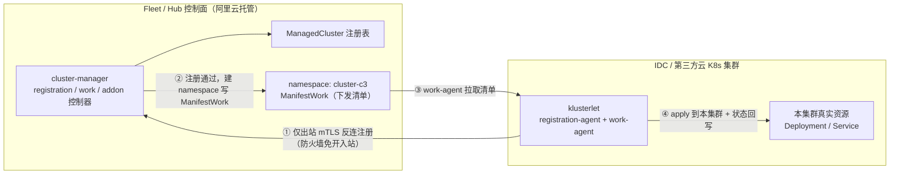
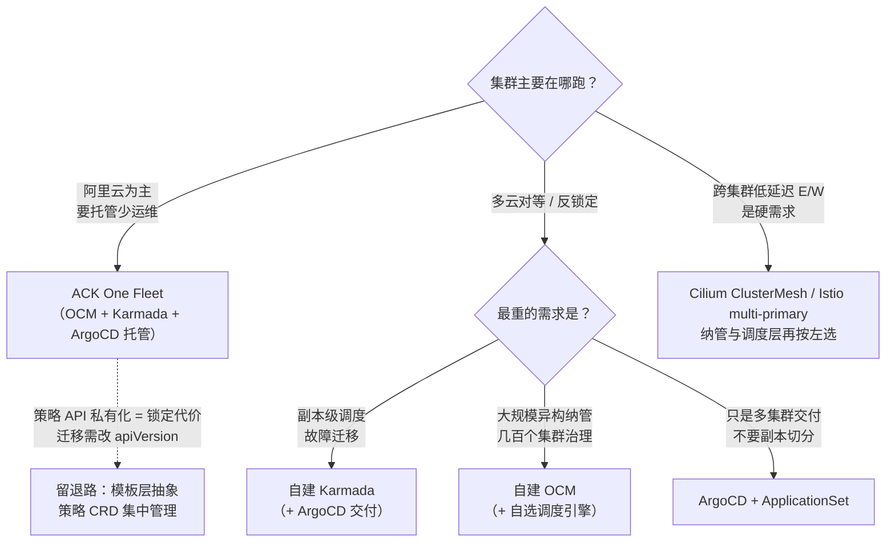

# ACK One 为何选型 OCM —— 多集群纳管层选型逻辑深剖

> **前置阅读**: [[wiki/18-云厂商/01-阿里云/分布式云-ACKOne/01-ack-one-multi-cluster-architecture.md|ACK One 多集群架构深度剖析]]（三层组合全景）、[[wiki/18-云厂商/01-阿里云/分布式云-ACKOne/02-karmada-deployment-distribution.md|Karmada 分发全链路]]（调度层细节）
>
> 本文回答一个更窄的问题：**Fleet 的纳管层为什么是 OCM？其他路线为什么没走通/何时反而成立？**

---

## 📋 目录

- [一、结论先行](#一结论先行)
- [二、先把问题域切对：选型争论大多因为没分层](#二先把问题域切对选型争论大多因为没分层)
- [三、OCM 是什么：把集群当 Node 管的治理扩展](#三ocm-是什么把集群当-node-管的治理扩展)
- [四、五条选型逻辑（每条带反事实）](#四五条选型逻辑每条带反事实)
- [五、反事实推演：其他候选为何出局 / 何时反而成立](#五反事实推演其他候选为何出局--何时反而成立)
- [六、云厂商路线对照：开源同源 vs 全自研](#六云厂商路线对照开源同源-vs-全自研)
- [七、成熟度反差：调度层选毕业的 Karmada，纳管层选 Sandbox 的 OCM](#七成熟度反差调度层选毕业的-karmada纳管层选-sandbox-的-ocm)
- [八、决策树：把这套逻辑泛化到你的场景](#八决策树把这套逻辑泛化到你的场景)
- [九、面试口径](#九面试口径)
- [十、参考链接](#十参考链接)

---

## 一、结论先行

**"ACK One 选型 OCM"是一个不完整的命题**。完整表述是：Fleet 按"纳管 / 调度 / 交付 / 数据面"四层各选其长，OCM 只中标了纳管层。

一句话根本逻辑：

> **纳管层选自己参与定义的开放标准**（OCM 由 Red Hat + 蚂蚁集团 + 阿里云于 2021-11 联合发起开源，是 Red Hat ACM 的上游）——用一条与上层引擎解耦的"薄底座"，换取分发引擎的整体可替换性。回报已经兑现：Fleet 的应用分发形态从 KubeVela Application（2023）整体切换为 Karmada 语义，**纳管层纹丝未动**。

| 层 | 中标者 | 主要落选者 | 一句话原因 |
|---|---|---|---|
| 纳管（注册/通道/add-on） | **OCM** | Karmada 注册、自研、Clusternet | 发起方同源 + 薄底座职责匹配 + 解耦 |
| 调度（副本切分/重调度） | **Karmada 内核**（托管变体） | KubeFed、OCM Placement、ApplicationSet | 社区最强副本级调度，且已 CNCF 毕业 |
| 交付（GitOps） | **Argo CD** | Flux、Rancher Fleet | 事实标准 + 阿里云 Argo 生态协同 |
| 数据面（N/S 网关、E/W 服务） | **MSE/ALB 网关 + 多集群 Service** | ClusterMesh、Submariner | 与阿里云网络产品（CEN/专线）天然集成 |

---

## 二、先把问题域切对：选型争论大多因为没分层

"OCM vs Karmada vs ArgoCD 谁更好"是伪对立——**它们不在同一层竞争**。CNCF 官方博客的定位：Karmada 是面向多集群编排的独立控制平面（强调度），OCM 是基于现有集群的治理扩展框架（强纳管、模块化，供其他工具在其上构建），二者互补。

分层视角下各层的候选清单：

| 层 | 职责 | 该层候选 |
|---|---|---|
| **纳管层** | 集群注册、身份与证书、状态上报、工作负载下发通道、扩展组件（add-on）生命周期 | OCM、Karmada registration、Clusternet、自研 agent（Anthos GKE Hub / Azure Arc / EKS Connector）、Rancher |
| **调度层** | 副本切分、动态权重、重调度、故障迁移、差异化改写 | Karmada、KubeFed v2（死）、KubeAdmiral、OCM Placement（只选集群不切副本）、Argo Rollouts（发布视角） |
| **交付层** | Git→多集群的持续交付、漂移收敛 | Argo CD（+ApplicationSet）、Flux、Rancher Fleet |
| **数据面** | 跨集群 N/S 入口、E/W 服务发现与互通 | 托管网关（MSE/ALB）、多集群 Service、ClusterMesh、Istio multi-primary、Submariner、MCS API |

ACK One 的答案是每层取最强（见 [[wiki/18-云厂商/01-阿里云/分布式云-ACKOne/01-ack-one-multi-cluster-architecture.md|架构深度剖析]] 第一节），而"为什么纳管层是 OCM"是四层中战略味道最重的一问。

---

## 三、OCM 是什么：把集群当 Node 管的治理扩展

### 3.1 出身与血统

- **2021-11-09**：Red Hat、蚂蚁集团、阿里云联合宣布 OCM 开源，同日进入 CNCF Sandbox（至今仍为 Sandbox，见第七节）。
- **Red Hat ACM（Advanced Cluster Management）的上游开源版**——ACM 商业产品验证过的注册/下发底座。
- **蚂蚁侧同源生态**：KubeVela 多集群体系（oam-dev/cluster-gateway 聚合访问网关）同样构建在 OCM 之上，阿里系内部两条产品线共享同一套纳管底座。

### 3.2 核心模型：集群即节点

| 对象/组件 | 位置 | 作用 | K8s 类比 |
|---|---|---|---|
| `ManagedCluster` | Hub | 集群注册表：身份、状态（Joined/Available）、标签、taint | **Node 对象** |
| `Klusterlet`（registration-agent + work-agent） | Spoke 成员集群 | 出站反连 Hub：注册、上报状态、拉取并 apply 下发清单 | **kubelet** |
| `ManifestWork` | Hub 的 `cluster-<name>` 命名空间 | 下发载体：一份完整资源清单，work-agent 拉取后在成员集群 apply | Pod spec（"整份下发"） |
| `Placement` | Hub | 按标签/ClusterSet/taint 做集群筛选，产出"选中集群名单" | **nodeSelector/调度过滤** |
| `ManagedClusterAddOn` | Hub + Spoke | 扩展组件（监控/备份/安全 agent）的托管下发与注册 | DaemonSet+operator 合体 |
| `ManagedClusterSet` / `ClusterClaim` | Hub | 集群分组与属性声明 | namespace/label 语义 |

架构哲学：**manage clusters like nodes**——成员集群在 Hub 眼里就是一种特殊的 Node；注册接入要 `clusteradm accept`（等价于给 Node 加 toleration），Placement 像调度 Pod 一样"调度集群"。这套语义对 K8s 使用者是零学习成本的。

### 3.3 pull 模式：IDC 混合云的物理正确性

关键点：**agent 只做出站连接**（mTLS + 证书轮换），Hub 不需要能"够到"成员集群——IDC 防火墙/NAT 环境零改造接入。这是混合云纳管通道的物理正确解，也是评估一切纳管方案的第一道筛子。

### 3.4 能力边界（最重要的一条面试点）

**OCM 不做副本级调度**。`Placement` 只产出"哪些集群被选中"，`ManifestWork` 是"整份清单下发"——成员集群要么有这个应用要么没有，**不能把 10 个副本切成 7+3**。副本切分、动态权重、故障迁移是上层调度引擎（Karmada）的活。

这个"缺陷"恰是选型逻辑的钥匙：**OCM 把自己做成可被替换上层引擎的底座**——它不下场做调度，所以谁能当调度引擎它是中立的。

---

## 四、五条选型逻辑（每条带反事实）

### 4.1 同源发起：不是采购，是共创

OCM 是阿里云与蚂蚁**参与定义**的项目（2021-11 与 Red Hat 联合发起），不是市面上挑来的第三方。官方对 Fleet 的原话："基于成熟的开源社区项目 Argo CD 和 Open Cluster Management 构建，保证了产品的开放性"。

> **反事实**：若外购一个成熟度更高的第三方项目（如 Rancher 内核），社区治理与 roadmap 不在自己手里——云产品要的"纳管层深度定制 + 长期演进主导权"就悬了。发起方身份让这层风险归零，还反向输出了"阿里参与定义行业标准"的叙事。

### 4.2 职责匹配：纳管层要的就是"薄底座"

注册、证书轮换、状态上报、下发通道、add-on 生命周期——这些活**没有差异化价值**（做出来不会有人因为"你的集群注册特别好"选你），但**缺了全盘皆输**。这类无差异化、重打磨的底座，社区共建最划算；云厂商的弹药应该花在有差异化的调度内核（Karmada 语义托管）和云产品数据面（MSE/ALB 网关、多集群 Service）上。

> **反事实**：自研纳管通道 = 投入工程团队维护一份与友商重复的代码，且要自己扛证书轮换、弱网重连、大规模上报这些"脏活"的全部 bug。

### 4.3 解耦实证：分发引擎换血，纳管层纹丝不动

这是五条里唯一有**产品史证据**的一条：Fleet 的应用分发形态 2023 年是 KubeVela Application（`core.oam.dev`，`topology` 策略 + `publishVersion` 注解），现行主推形态已整体切换为 Karmada 语义的 `PropagationPolicy`/`OverridePolicy`（`policy.one.alibabacloud.com`）——事件流里的控制器从 Vela 换成了 `karmada-scheduler`/`karmada-descheduler`，但下层的 `ManagedCluster`/`Work` 纳管通道**一天都没换过**。两层之间那条缝就是 OCM 的 Work API。

> **反事实**：如果当初选了"纳管+调度一体"的框架（如全 Karmada 全栈），换调度引擎 = 整个纳管层重做，产品断代。

### 4.4 生产背书：ACM 上游打磨过的脏活

OCM 的注册证书轮换、弱网重连、大规模集群状态聚合、add-on 插件框架，全部经过 Red Hat ACM 企业客户的生产验证。ACK One 注册集群的扩展能力（监控/备份/巡检 agent 纳管）就跑在 OCM add-on 框架语义上；注册集群另提供**受限模式**（agent 不读取集群内其他信息），安全边界清晰。

### 4.5 开放性：接入层不设私有协议陷阱

Fleet 上 `kubectl get managedclusters`（HUB ACCEPTED/JOINED/AVAILABLE 就是 OCM clusteradm 语义）、AMC CLI、`work.one.alibabacloud.com` API 组——纳管层暴露的是**标准 OCM 语义**。客户"集群怎么接进来"这一层不被私有协议锁死（锁定发生在调度层 API 私有化上，见 [[wiki/18-云厂商/01-阿里云/分布式云-ACKOne/01-ack-one-multi-cluster-architecture.md|架构深度剖析]] 第十节的取舍提示——接入开放、调度绑定，是精心设计的锁定梯度）。

> **反事实**：私有协议接入 = 客户最大的迁移恐惧点，混合云销售时反而减分。

---

## 五、反事实推演：其他候选为何出局 / 何时反而成立

| 候选 | 出局原因 | 何时反而成立 |
|---|---|---|
| **Karmada 全栈**（自带 registration） | 定位是独立多集群调度控制面；CNCF 官方口径与 OCM 互补：一个管"编排"一个管"纳管" | **多云对等、反锁定**时的自建首选；事实上 ACK One 的调度层就是它 |
| **自研通道**（Anthos GKE Hub / Azure Arc / EKS Connector 路线） | 成立但丢开放性叙事，纯增维护成本 | 封闭生态战略的厂商（Google/Microsoft/AWS 正是这么干的，见第六节） |
| **Clusternet**（腾讯开源） | 定位与 OCM 相似，但社区由竞对主导 | 腾讯系产品线 |
| **Rancher** | 纯 Hub-Spoke 管理台，无副本级调度；SUSE 商业产品 | 多云治理合规、以 UI/运维中台为中心的团队 |
| **Red Hat ACM 商业版** | OCM 的商业发行版——买竞对的商业产品做自家内核不可能 | 企业客户直接采购 ACM/消费 Red Hat 订阅 |
| **KubeFed v2** | 社区停滞（SIG Multicluster 已解散），Karmada 是其精神续作 | 不成立，仅作历史坐标 |
| **Argo CD ApplicationSet 单打** | 无集群纳管、无副本切分，只管"整份交付" | 需求止步于多集群交付时（事实上它也被叠加为交付层） |
| **KubeVela** | 曾中标**分发层**（2023 形态）后被 Karmada 语义替换 | OAM/应用模型为中心的交付场景——它的离场恰恰证明"分发层可换、纳管层不换"的分层价值 |
| **KubeAdmiral**（阿里 2023 开源） | 阿里系第三条路线（内部大规模多集群实践外化，偏 K8s 原生联邦调度），ACK One 产品主线未采用 | 阿里内部超大场景 / 需要更强联邦调度语义的开源用户 |
| **数据面路线**（ClusterMesh / Istio multi-primary / Submariner） | 不同问题域——它们解决 E/W 互通，不做纳管不做调度 | 跨集群低延迟服务调用是硬需求时叠加使用（与 ACK One 不互斥） |

三条元规律：

1. **竞对主导的开源项目自动出局**（Clusternet）——开源选型从来不只是技术题。
2. **"一体式框架"输给"分层组合"**——一体式（Karmada 全栈/Rancher）赢在简单，输在演进弹性；ACK One 需要每层独立演进。
3. **无差异化的层用开放标准，有差异化的层才自持**——接入层开放（OCM 标准语义），调度层绑定（`policy.one.alibabacloud.com` 私有 API 组），锁定是有梯度的设计而非偶然。

---

## 六、云厂商路线对照：开源同源 vs 全自研

| 云厂商 | 多集群产品 | 纳管通道 | 调度/编排 | 路线 |
|---|---|---|---|---|
| 阿里云 | ACK One | **OCM**（同源发起） | Karmada 语义托管变体 + ArgoCD | **开源同源** |
| Google | Anthos | GKE Hub / Connect agent（自研） | Config Sync + ASM（自研/Istio） | 全自研 |
| Microsoft | Azure Arc | 自研 agent | 开源 **KubeFleet**（Azure/fleet）+ Flux 扩展 | 自研接入 + 开源编排 |
| AWS | EKS Anywhere/Connector | EKS Connector（自研） | 生态拼接（ArgoCD/ACM GS 等） | 自研接入 + 生态拼接 |

**自研纳管是多厂商主流**，阿里云的开源同源才是差异点。这背后的一致逻辑是：**纳管通道本身不产生差异化收入**——各家的钱都在调度内核、云产品数据面（各家网关/Service Mesh 产品）和生态锁定上。阿里云把底座开放出去，反而扩大了"任意集群都能接进来"的地盘，再用云产品变现——这比 Anthos/Arc 的封闭接入在混合云销售上多了一个"不怕锁定"的卖点。

---

## 七、成熟度反差：调度层选毕业的 Karmada，纳管层选 Sandbox 的 OCM

一个高频质疑：**"OCM 至今还是 CNCF Sandbox，Karmada 都毕业了，为什么调度层选毕业项目、纳管层反而选 Sandbox 项目？"**

| 项目 | CNCF 时间线 | 现状 |
|---|---|---|
| OCM | 2021-11-09 进 Sandbox | **至今 Sandbox** |
| Karmada | 2021-09-14 Sandbox → 2023-12-12 Incubating | **已 Graduated**（毕业） |

答法是**"徽章 ≠ 成熟度，每层按自己最重的权重选"**：

- **纳管层最重的是生产背书与治理掌控**：OCM 的真实成熟度锚点是 Red Hat ACM 的企业客户群（ACM 的注册/下发底座就是 OCM），Sandbox 徽章只是形式；加上阿里自己是发起方，"项目弃坑"风险由自己兜底——这层风险对发起方不是风险。
- **调度层最重的是社区活力与生态位**：副本级调度是产品核心能力，Karmada 的社区规模、贡献者数量、CNCF 毕业进度直接决定这层的长期供给，所以选毕业项目。
- 面试加分点：能讲出"成熟度评估要看该层失败的代价"——纳管层出问题的代价是"接不进来"（可用性单调，OCM 足够成熟），调度层出问题的代价是"分发错误"（业务正确性，要最强的社区迭代速度兜底）。

---

## 八、决策树：把这套逻辑泛化到你的场景

ACK One 的选型逻辑可以压缩成一个可复用的决策框架：

信号词速查：

| 客户/面试官的话 | 指向 |
|---|---|
| "两地三中心""同城双活""IDC 弹性上云" | ACK One（注册集群 + 多集群网关） |
| "多云对等""不要被厂商锁定" | 自建 Karmada / OCM + ArgoCD |
| "几百个集群，异构，IDC 为主" | OCM 底座（ACM 或自建） |
| "只要 GitOps 统一发布" | ArgoCD + ApplicationSet，别上重炮 |
| "跨集群服务调用延迟敏感" | 数据面 ClusterMesh/Istio，与纳管层正交 |

---

## 九、面试口径

**一句话**：ACK One 只在纳管层选了 OCM——因为阿里云+蚂蚁是 OCM 的联合发起方（2021-11 与 Red Hat 共同开源），用自己参与定义的开放标准做"薄底座"，调度层留给 Karmada 内核，两层靠 Work API 解耦；分发引擎从 KubeVela 切到 Karmada 而纳管层纹丝不动，就是这个选型的回报。

**30 秒答**：先分层——纳管 OCM（ManagedCluster/klusterlet pull 反连/ManifestWork/add-on），调度 Karmada 托管变体（PropagationPolicy 切副本/重调度），交付托管 ArgoCD，数据面 MSE/ALB 网关+多集群 Service。选 OCM 五条：同源发起、薄底座职责匹配（注册/证书/通道无差异化价值，社区共建最划算）、解耦实证（分发层换血纳管层不动）、ACM 上游生产背书、标准 OCM 语义开放不锁定。备选出局：Karmada 全栈（CNCF 口径与 OCM 互补——独立调度控制面 vs 治理扩展）、自研（Anthos/Arc 路线丢开放性）、Clusternet（竞对主导）、KubeFed（停滞）、Rancher/ACM（商业竞品+无副本调度）。

**高频追问**：

1. **"为什么不全用 Karmada？它自带注册"** → 定位不同：Karmada 是独立多集群控制面（编排），OCM 是治理扩展框架（纳管）；CNCF 官方口径互补。ACK One 要纳管层稳定 + 调度层可演进，一体式框架做不到解耦（举 KubeVela→Karmada 切换实证）。
2. **"OCM 和 Karmada 一句话区别"** → OCM 管"集群怎么进来、东西怎么送下去"（注册/通道），Karmada 管"每个集群分几个、坏了怎么搬"（副本调度）。金句：**Placement 只决定选哪些集群，不决定每家分几个副本**。
3. **"OCM 怎么穿透 IDC 防火墙"** → klusterlet 只出站反连 Hub（mTLS+证书轮换），零入站开洞；注册集群另有受限模式。
4. **"OCM 还是 Sandbox，敢用吗"** → 见第七节：徽章≠成熟度，ACM 上游生产背书 + 发起方兜底；调度层才需要毕业项目的社区活力。
5. **"迁移成本"** → 调度层有绑定：`policy.one.alibabacloud.com`/`work.one.alibabacloud.com` 私有 API 组，开源 Karmada YAML 改 apiVersion 才能进 Fleet；接入层无私有协议。

**红线**：

- ❌ 说"ACK One 是基于 Karmada 的产品"——全称命题错（纳管 OCM、调度 Karmada、交付 ArgoCD）。
- ❌ OCM = Red Hat ACM——OCM 是上游开源项目，ACM 是商业发行版。
- ❌ 把 OCM 说成多集群调度器——Placement 只选集群，不切副本。
- ❌ 说开源 Karmada YAML 可原样搬进 Fleet——apiVersion 不同。
- ❌ 忘了 Fleet 是管理面不是数据面——Fleet 宕机只断变更能力，不断存量业务。

---

## 十、参考链接

1. CNCF 项目页 · Open Cluster Management（2021-11-09 Sandbox）: https://www.cncf.io/projects/open-cluster-management
2. CNCF 项目页 · Karmada（Sandbox→Incubating→Graduated）: https://www.cncf.io/projects/karmada
3. CNCF 官方博客 · Karmada 和 OCM：多集群舰队管理的两种新思路: https://www.cncf.io/blog/2022/09/26/karmada-and-open-cluster-management-two-new-approaches-to-the-multicluster-fleet-management-challenge
4. OCM 官方 FAQ（vs Karmada）: https://open-cluster-management.io/docs/faq
5. OCM 官方文档: https://open-cluster-management.io
6. Red Hat 和蚂蚁、阿里云共同开源 OCM（2021-11 发布背景）: https://zhuanlan.zhihu.com/p/393956472
7. ACK One 构建混合云同城容灾系统（官方"Fleet 基于 Argo CD 和 OCM 构建"表述）: https://www.cnblogs.com/alisystemsoftware/p/18020784
8. 创建 ACK One 注册集群（官方文档，含受限模式）: https://help.aliyun.com/zh/ack/distributed-cloud-container-platform-for-kubernetes/user-guide/create-ack-one-registered-clusters
9. KubeAdmiral（阿里开源多集群编排）: https://github.com/kubeadmiral/kubeadmiral
10. Clusternet（腾讯开源多集群管理）: https://github.com/clusternet/clusternet
11. Azure KubeFleet（Azure/fleet 开源应用编排）: https://github.com/Azure/fleet
12. K8s 多集群管理架构与 API 演进综述: https://jimmysong.io/zh/book/kubernetes-handbook/multi-cluster/multi-cluster-services-api

## Related

- [[wiki/18-云厂商/01-阿里云/分布式云-ACKOne/01-ack-one-multi-cluster-architecture.md|ACK One 多集群架构深度剖析]]
- [[wiki/18-云厂商/01-阿里云/分布式云-ACKOne/02-karmada-deployment-distribution.md|Karmada 分发全链路]]
- [[wiki/27-资产/architecture-diagrams/architecture-multi-cluster.md|多集群架构模式]]
- [[wiki/05-网络/03-服务网格/14-cilium-mesh-multi-cluster-networking.md|Cilium Mesh 多集群网络实践]]
- [[wiki/20-最佳实践/09-large-scale-production/10-multi-cluster.md|多集群与联邦管理最佳实践]]
