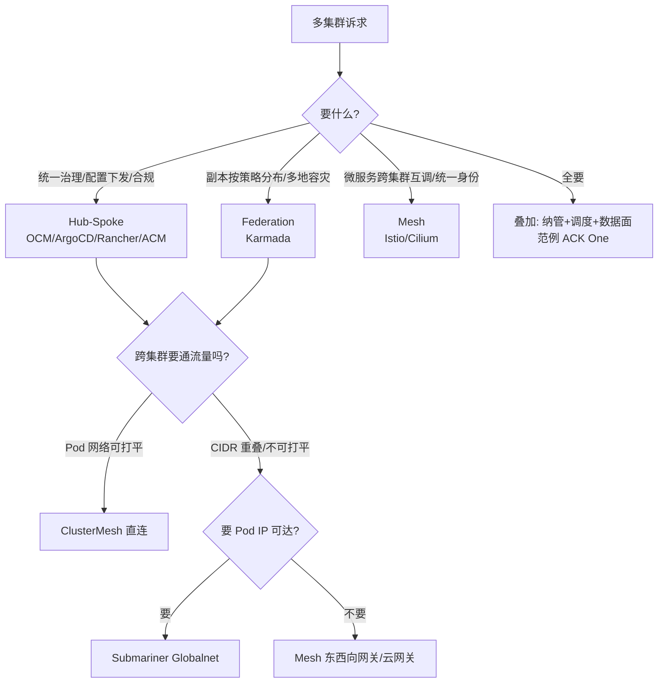

---
sources:
- "wiki/27-资产/architecture-diagrams/architecture-multi-cluster.md"
- "wiki/18-云厂商/01-阿里云/分布式云-ACKOne/01-ack-one-multi-cluster-architecture.md"
- "wiki/20-最佳实践/09-large-scale-production/10-multi-cluster.md"
- "https://github.com/kubernetes/enhancements/blob/master/keps/sig-multicluster/1645-multi-cluster-services-api/README.md"
- "https://docs.cilium.io/en/latest/network/clustermesh/mcsapi"
- "https://karmada.io/docs/userguide/failover/application-failover"
- "对话沉淀: 2026-10-20 多集群架构模式拓展讨论"
title: 多集群架构模式深挖：故障域、服务发现标准、E/W 路线与拆分取舍
summary: 在三种多集群模式（Hub-Spoke / Federation / Service Mesh）资产图之上补齐"判断层"——每种模式的故障域与控制面失效行为（Hub 挂、Karmada 挂、istiod 挂各丢什么）、跨集群服务发现的标准化现状（MCS API v1alpha1 与实现矩阵）、E/W 流量四条路线与 CIDR 重叠处理、单大集群 vs 多集群的拆分判断、容灾切流三段链路与 RTO/RPO 边界。
category: concepts
tags:
- multi-cluster
- hub-spoke
- federation
- karmada
- ocm
- service-mesh
- mcs-api
- clustermesh
- submariner
- disaster-recovery
tier: core
created: 2026-10-22
updated: 2026-10-22
last_updated: 2026-10
status: stable
difficulty: advanced
reading_level: advanced
audience:
- SRE
- 平台工程师
- 解决方案架构师
- TAM
estimated_read_time: 25min
intent_queries:
- Hub-Spoke / Federation / Service Mesh 三种多集群模式怎么选
- Hub 集群挂了 Spoke 上的业务会停吗
- Karmada 控制面挂了 / istiod 挂了影响什么
- ServiceExport ServiceImport clusterset.local 是什么，MCS API 现状
- 两个集群 Pod CIDR 重叠怎么互联
- 一个大集群还是多个小集群
- 多集群容灾切流怎么做，RTO 由什么决定
trigger_keywords:
- multi-cluster
- hub-spoke
- karmada
- failover
- ServiceExport
- ServiceImport
- clusterset.local
- clustermesh
- submariner
- globalnet
- east-west gateway
- RTO
- 故障域
k8s_versions:
- '1.28'
- '1.30'
- '1.34'
---

# 多集群架构模式深挖：故障域、服务发现标准、E/W 路线与拆分取舍

三模式的"是什么"看两张图就够了：[[wiki/27-资产/architecture-diagrams/architecture-multi-cluster.md|多集群架构模式资产图]]（Hub-Spoke / Federation / Mesh 三模式 + ACK One 定位）与 [[wiki/18-云厂商/01-阿里云/分布式云-ACKOne/01-ack-one-multi-cluster-architecture.md|ACK One 多集群架构深度剖析]]（云产品化实例）。部署"怎么做"看 [[wiki/05-网络/01-K8s网络核心/34-multi-cluster-networking.md|多集群网络互联]] 与 [[wiki/05-网络/01-K8s网络核心/51-multicluster-network-federation.md|多集群网络联邦]] 的配方。本文补的是中间缺的那层——**判断**：每种模式挂掉会怎样、服务发现有标准了吗、网络怎么打、集群该不该拆、容灾 RTO 由什么决定。配套面试卡 Q109–Q114（`maintaining/04-报告/k8s-高级面试快问快答-沉淀.md` 多集群专项）。

## 一、一张判别表：同步什么、方向如何、流量过不过

三种模式不是三选一，是三个抽象层。判别只要三问：**同步的是什么？方向如何？业务流量过不过它？**

| 维度 | Hub-Spoke | Federation | Service Mesh |
|---|---|---|---|
| 同步的"物" | 配置/manifest/策略/RBAC/证书 | 工作负载声明（副本切分策略） | 服务注册/endpoint/身份 |
| 方向 | 单向下发（pull 反连） | 下发 + 状态回报 | 双向服务发现 |
| 业务流量过控制面 | ❌ | ❌ | ❌（仅 xDS 配置；数据面直连） |
| 跨集群流量能力 | ❌ 需外部 LB | ❌ 需伴生 Mesh | ✅ 原生 mTLS |
| 全局调度 | ❌ | ✅ 副本权重/重调度 | ⚠️ 仅 Locality 级 |
| 控制面挂了丢什么 | 下发与漂移纠偏 | 重调度与故障迁移 | 新配置与证书续签 |
| 代表 | OCM / ArgoCD / Rancher / ACM | Karmada / KubeFed v2(归档) | Istio / Cilium / Linkerd |

两个常见的"层混淆"都在这张表里有答案：OCM 的 Placement 只选集群不切副本（所以上层必须叠 Karmada，见 [[wiki/18-云厂商/01-阿里云/分布式云-ACKOne/03-ack-one-ocm-selection-rationale.md|ACK One 为何选型 OCM]]）；ArgoCD ApplicationSet 是模板展开不是联邦调度（没有副本权重与故障迁移）。N/S 入口流量是第四块拼图——多集群 Ingress / Gateway API 多集群网关，三种模式都不管。

## 二、故障域深挖：控制面挂了，业务怎样

面试里的高分句式是三问法："**谁在物化资源？谁在推配置？谁有到期物？**"——物化在成员集群本地的（kube-controller-manager 维持 Deployment 副本、kube-proxy 写 iptables/eBPF），控制面挂了照常工作；只有"推配置"的通道断了；真正会咬人的是**到期物**：证书、lease、token。

| 组件挂 | 立即影响 | 延迟影响（定时炸弹） | 恢复后风险 |
|---|---|---|---|
| OCM Hub | Spoke 不再收新 ManifestWork，klusterlet 断线重连 | 无（已物化资源由本地维持） | 全量对账把应急手改冲回 |
| ArgoCD Hub | 不再 sync/self-heal，漂移不可见 | 无 | 同上——漂移期间的手改被纠正回"错误"版本 |
| Karmada 控制面 | 不重调度、不 failover、不改副本分布；集群失联判定停止 | 无（成员集群 Work 已物化） | 失联期间的手工扩容/迁移被覆盖 |
| istiod | 新 Pod 拿不到注入配置与证书；路由变更不生效 | **工作负载证书默认 24h 到期**，大面积 mTLS 握手失败 | 低（reconnect 后 xDS 全量推送） |
| clustermesh-apiserver（Cilium） | 远端 endpoints 视图冻结（stale） | 本地流量不受影响，远端变化不同步 | 视图追赶期可能短暂误删远端后端 |

要点展开：

1. **Hub-Spoke 是 pull 模式救了可用性**：klusterlet / ArgoCD agent 只出站反连（IDC 防火墙不用开入站端口），Hub 故障不会反向传染 Spoke；但也意味着 Hub 挂期间**治理是盲的**——没人纠偏、没人审计。
2. **Karmada 的 push/pull 选择影响故障传播**：push 模式 Karmada 主动连成员 apiserver（Hub→成员方向要开网络）；pull 模式 `karmada-agent` 出站反连。ACK One Fleet 托管 Hub 把这份 HA 责任交给了云厂商。
3. **istiod 的 24h 证书是 Mesh 特有的"软死亡"**：挂掉当下没人察觉，第二天集中爆发。监控指标（`pilot_xds_pushes`、citadel CSR 系列）要按"istiod 不可用持续时间 > 12h 就升级"来设阈值，而不是等故障。
4. **Karmada 自己挂时容灾能力整体离线**：`cluster-failure-threshold`（默认约 30s 判失联）与 `failover-eviction-timeout`（默认约 5 分钟后驱逐）这些定时器全停——"有容灾机制"≠"容灾机制高可用"。

> 应急纪律：故障期间在成员集群的手工改动，必须同步落到 Hub（或先暂停该应用 sync），否则恢复后的对账会把它冲掉。这是 Hub-Spoke 模式最真实的"恢复即复发"事故源。

## 三、服务发现标准化：MCS API（KEP-1645）

### 3.1 三个前置概念

- **ClusterSet**：一组互信集群（互信 = 共享服务发现与身份的边界）。
- **namespace sameness**：同名 namespace 在 ClusterSet 内被视为"同一个 namespace"——这是跨集群合并端点的前提，**也是安全模型的隐含假设**：`default` namespace 在两个集群里被当成了同一个租户。
- **ServiceExport / ServiceImport**：源集群显式导出（默认不导出是安全默认值）；消费侧的 ServiceImport 由控制器**自动派生**，不手写。

### 3.2 机制与最小用法

```yaml
# 源集群：与 Service 同名同 namespace 即可
apiVersion: multicluster.x-k8s.io/v1alpha1
kind: ServiceExport
metadata:
  name: payment        # = Service 名
  namespace: prod      # = Service ns
```

控制器随后把远端 endpoints 同步为本地 EndpointSlice（标签 `multicluster.kubernetes.io/service-name`），DNS 提供 `<svc>.<ns>.svc.clusterset.local`：ClusterSetIP 型返回聚合 ClusterIP，Headless 型返回各 Pod 记录（可加 `<clusterid>.` 前缀做集群定向）。

### 3.3 现状与实现矩阵（版本敏感，答前先报）

**MCS API 至今仍是 v1alpha1**（`sigs.k8s.io/mcs-api`，2026 年没有 beta、未内置进 kube-apiserver，落地形态是 CRD + 外部控制器）。

| 实现 | 形态 | 备注 |
|---|---|---|
| Submariner Lighthouse | 最早的 MCS 实现 | 配 Globalnet 解决 CIDR 重叠 |
| Cilium ≥1.17 | **Beta**（MCS-API） | 与旧版 Global Services 注解 `service.cilium.io/global` 并存 |
| Istio | **不走 MCS** | 自有 registry 合并（namespace sameness 思想同源），1.8 起废弃 `.global` 改 DNS proxying + 同名合并 |
| GKE MCS | 云产品实现开放 MCS API | Fleet 内 ServiceExport |
| ACK One 多集群 Service | 云产品化变体 | 见 ACKOne 深挖 |

### 3.4 边界（红线区）

MCS **只管"发现"，不管"可达"，也不管"策略"**：Pod 间网络可达性仍要靠 ClusterMesh / 隧道 / 云网络打通；跨集群 NetworkPolicy 是否生效取决于 CNI 实现，MCS 不定义。把它说成"跨集群网络的解决方案"是面试常见翻车点。

## 四、E/W 路线四选一：能否打平、要不要直连

| 路线 | 前提 | CIDR 重叠 | 延迟/开销 | 身份 | 代表 |
|---|---|---|---|---|---|
| ① 扁平直连 | Pod CIDR 全局不重叠 + 节点互通（专线/VPN） | ❌ 不可用 | 最低，Pod-to-Pod 直达 | 共享 CA + cluster 身份 | Cilium ClusterMesh |
| ② 隧道+网关 | 网关间可通 | ✅ Globalnet NAT 兜底 | 中，隧道一跳 | 隧道加密 + 共享 CA | Submariner |
| ③ Mesh 东西向网关 | 仅网关 IP 互通 | ✅ 天然不依赖 Pod 可达 | 中，代理一跳 | SPIFFE/mTLS 全程 | Istio east-west gateway |
| ④ 云产品网关 | 云内网/专线 | ✅ 不要求全局规划 | 中 | 云身份/托管证书 | ACK One 多集群 Service、GKE MCS |

判断顺序两问：先问"**Pod 网络能否打平**"（专线 + CIDR 登记规划）——能则①，性能与可观测（Hubble 跨集群身份）最好；不能则问"**要不要 Pod IP 可达**"——不需要就③/④（网关代理），需要就②。

硬约束清单（比选型本身更容易被追问）：

- **Cilium ClusterMesh 四要素**：每集群唯一 `cluster.name` 与 `cluster.id`（默认 1–255，1.16+ 可扩到 511）、Pod CIDR 不重叠、节点间可达、共享 CA（各集群自签 CA 时要互相分发并做 verify）。clustermesh-apiserver 的对外暴露是攻击面，来源要锁。
- **Istio 拓扑矩阵**：multi-primary（每集群 istiod，互 watch 对方 apiserver，需 remote secret）× primary-remote（单 istiod 托管远端纯数据面），再乘同网络/跨网络（跨网络才需 east-west gateway）。
- **身份**：SPIFFE trust domain 规划——共享 root CA（ClusterMesh 要求）还是各自 intermediate CA 签发（Istio 推荐 `Federation` 模型），决定了跨集群 mTLS 的信任链。
- **"网段不登记就建集群"是反模式**：IP 重叠后跨集群互联永久无解，Globalnet 是补救不是设计。

## 五、一个大集群还是多个小集群

上游测试规模上限（5000 节点 / 15 万 Pod / 30 万容器 / 单节点 110 Pod）只是硬顶；etcd 建议 db ≤ 8GB。**真正逼你拆集群的是爆炸半径、合规分区、升级窗口、信任边界——不是规模**。

四个合理拆分触发：①一次 apiserver/etcd/CNI 升级事故不能带走全部业务（故障域隔离）；②监管要求数据不出域 / 等保分区（合规域）；③业务线接受不了统一维护窗口（升级独立，蓝绿换集群优于原地升级）；④namespace 级隔离不够时的信任边界（集群是最硬的隔离）。

不该拆的信号：部门各自开集群（治理成本指数上升）、用多集群掩盖调度/配额治理问题、没做网段登记与统一身份就铺集群。多集群的隐性前提是**治理三件套**：模板化建集群（Cluster API / Terraform）、统一身份（SSO/RAM 映射 RBAC）、统一可观测（跨集群指标联邦）——缺了就是几个更大的孤岛。

成熟度阶梯（别跳级）：单集群 → 多环境 Hub-Spoke → 多地 Federation → 跨集群微服务 Mesh。每上一级多一层控制面、多一份运维税。

## 六、容灾切流：三段链路与 RTO/RPO 边界

**切流三段**：探测（谁判定集群挂）→ 重调度（副本迁到健康集群）→ 流量切换（N/S 网关/DNS 权重，E/W Mesh locality failover）。

**RTO = 探测超时 + 决策 + 冷启动（镜像拉取/调度/启动探针）+ 流量收敛（DNS TTL、连接 draining）**；**RPO 取决于数据层，与 K8s 无关**——多集群控制面把 Pod 拉得再快，数据不同步就只是更快地服务脏数据。

Karmada 的两级 failover（答前先报版本口径）：

- **集群级**：成员集群 NotReady/Unknown 超过阈值（`cluster-failure-threshold`，默认约 30s）打 taint；`Failover` 特性门控开启且超过 `failover-eviction-timeout`（默认约 5 分钟）后加 NoExecute taint 触发驱逐重调度。
- **应用级**：`PropagationPolicy.spec.failover.application`——按资源健康解释器判定（`decisionConditions.tolerationSeconds`），`purgeMode: Directly | Graciously | Never`（v1.17 API 口径，旧版 Immediately）决定旧副本清理方式；Graciously 等新副本 Ready 再删（`gracePeriodSeconds` 兜底）。**失联集群上的 Directly 清理不保证执行**——控制面连不上它，故障迁移天然有一段"新旧双跑"窗口，有状态应用要靠 fencing/租约兜底（这是 Karmada 官方 issue 里明确的状态应用 failover 难点）。

Karmada 只负责"把 Pod 拉起来"（`karmada-scheduler-estimator` 先估容量避免迁过去 Pending）；流量段由多集群网关（健康探测 × 失败阈值 = 探测段 RTO 下限）与 Mesh locality/outlierDetection 兜底。

**同城双活 vs 两地三中心**：同城同步复制 RPO≈0 才谈真双活；异地异步复制 RPO>0，通常是冷备/只读。数据层三选项：同步双写（同城）、单写多读+主从切换（最常见）、单元化分片（异地也能双活但工程量最大）。演练铁律：切流演练 ≥2 次、回退条件前置写死（呼应 TAM 割接三件套，Q105）。

## 七、选型决策树



## 追问预判（面试）

| 追问 | 卡片 | 一句话锚点 |
|---|---|---|
| 三模式本质差别/为什么叠加 | Q109 | 三个抽象层：治理/调度/通信 |
| Hub 挂了业务会停吗 | Q110 | 控制面挂≠数据面停，三问法+证书定时炸弹 |
| ServiceExport 是什么/MCS 现状 | Q111 | v1alpha1，只管发现不管可达 |
| CIDR 重叠怎么互联 | Q112 | 四条路，ClusterMesh 排除法 |
| 该不该拆集群 | Q113 | 爆炸半径与合规触发，不是规模 |
| 容灾 RTO 谁决定 | Q114 | 探测+决策+冷启动+流量收敛；RPO 在数据层 |

## Related

- [[wiki/27-资产/architecture-diagrams/architecture-multi-cluster.md|多集群架构模式（三模式资产图）]]
- [[wiki/18-云厂商/01-阿里云/分布式云-ACKOne/01-ack-one-multi-cluster-architecture.md|ACK One 多集群架构深度剖析]]
- [[wiki/18-云厂商/01-阿里云/分布式云-ACKOne/02-karmada-deployment-distribution.md|一个普通 Deployment 的多集群之旅（Karmada 分发全链路）]]
- [[wiki/18-云厂商/01-阿里云/分布式云-ACKOne/03-ack-one-ocm-selection-rationale.md|ACK One 为何选型 OCM]]
- [[wiki/05-网络/01-K8s网络核心/34-multi-cluster-networking.md|多集群网络互联（部署配方）]]
- [[wiki/05-网络/01-K8s网络核心/51-multicluster-network-federation.md|多集群网络联邦（部署配方）]]
- [[wiki/05-网络/03-服务网格/14-cilium-mesh-multi-cluster-networking.md|Cilium Mesh 多集群网络实践]]
- [[wiki/22-概念/05-安全/multi-cluster-security.md|多集群安全]]
- [[wiki/22-概念/08-可靠性与运维/multi-cluster-dr-automation.md|多集群容灾自动化]]
- [[wiki/22-概念/08-可靠性与运维/cost-optimization-multi-cluster.md|多集群成本优化]]
- [[wiki/22-概念/06-可观测性/multi-cluster-observability-federation.md|多集群可观测联邦]]
- [[wiki/20-最佳实践/09-large-scale-production/10-multi-cluster.md|多集群与联邦管理最佳实践]]
- [[wiki/11-发布变更/01-GitOps/14-fleet-gitops-operations-guide.md|Fleet GitOps 运维指南]]
- 沉淀卡：`maintaining/04-报告/k8s-高级面试快问快答-沉淀.md` Q109–Q114（多集群专项）
